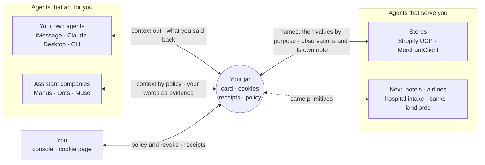

# Agent Cookie

**The cookie for AI agents.** An agent you have never used knows you on its first message, within a policy you own, with a receipt for every read, and it never holds your address or your card.

> The short overview is [README.md](README.md); 中文版：[README.zh.md](README.zh.md). The engineering plan and most evidence files are in Chinese; the SDK, gateway and package READMEs are in English.

---

## Why a cookie

In 1994 the web had a problem: every request arrived as a stranger, so a shopping cart could not survive the next click. The fix was a small token the site hands the browser and the browser hands back on the next visit, to that site only. Logins, carts and personalization followed, and with them e-commerce. The one thing left open was the third-party cookie, and it turned into cross-site tracking and a generation of consent banners.

Agents are where the web was before the cookie. Every assistant and every store agent meets you as a stranger and restarts the interview: your language, your size, your taste, your address. Each company keeps its own memory, so switching assistants means starting over and handing a new company everything.

Agent Cookie is the cookie for agents, with the 1994 lesson built in.

| The 1994 pitch | The 2026 pitch |
| --- | --- |
| The web is stateless. Every request is a stranger. | Agent conversations are stateless. Every agent is a stranger. |
| The site hands the browser a small token; the browser hands it back on the next visit. | The person's jar hands each agent a pairwise session ID and a handshake naming what it may know. |
| The site recognizes a returning visitor and keeps a cart, a login, preferences, with no user database of its own. | The agent knows the person on its first message and keeps its own note under its own ID, with no user database, no address, no card. |
| The user stops re-entering things. The state lives in the browser, where they can see and delete it. | The person stops re-answering. The profile lives in a jar they own, every read writes a receipt, and any cookie can be revoked. |
| A cookie goes back only to the site that set it. | One ID per agent, enforced: pairwise IDs cannot be joined, handshakes carry field names, values are released by purpose. |
| Left open: the third-party cookie. | Closed by construction: there is no global identifier to share. |

## What it does

Every person gets a **jar** with three objects inside.

| | What it is | What it guarantees |
| --- | --- | --- |
| **Identity card** | Agents contribute facts with provenance; deterministic rules merge them into fields. | What you said yourself counts at once. Learned preferences need independent sources, and stale ones decay. Guesses never reach the card. |
| **Conversation cookie** | Each agent gets its own pairwise session ID and, for a store, its own private note. | Stores get no shared identifier from us, so they cannot link you to each other through Agent Cookie. Switch assistants and the same store still recognizes you. |
| **Workspace** | Registers and matches agents, checks every read against policy, purpose, stage, expiry and revocation, and writes a receipt. | No model can grant itself access. Authorization is code, not a prompt. |

## One jar, every agent, and it learns back

The jar is not a pipe to stores. It is the context layer for every agent in a person's life, and it gets better each time one is used.

- **Agents that act for you** read the card by policy: your own agents (iMessage, Claude Desktop, the CLI) see all of it, an assistant company you linked once sees only what your policy allows. They write back what you told them, with your own words as evidence.
- **Agents that serve you** (stores today) get field names in the handshake, then values by purpose at the stage that needs them: your size with the request, your address at checkout, and only the one whose quote you accepted. They write back what they observed, and keep their own private note under their own pairwise ID.
- **You** set the policy, read every receipt, and revoke anything, from the console or the hosted cookie page.



**The feedback loop, and what keeps it clean.** Every write lands as a contribution with its source, and deterministic rules decide what reaches the card:

| Who writes back | What happens to it |
| --- | --- |
| You, through your own agent | On the card at once. The newest thing you said wins. |
| A linked assistant, with your own words as evidence | On the card while its link is live; back to a candidate if you revoke it. |
| A store or assistant that observed something | A candidate until a second, independent source agrees. Two records from one conversation are one source. |
| Any agent's guess (`inferred`) | Kept as that agent's own record. Never on the card. |
| A store's note about you | Private to that store's pairwise session. Never on the card, never seen by another agent. |
| An accepted purchase | Feeds preference learning, under the same rules. |
| Time | Stale values lose confidence and eventually drop off the card. |

So a store cannot write "this person is a VIP" into your profile, and an assistant cannot make a guess stick. The more agents you use, the fewer questions the next one asks, and nobody can poison the card on the way.

The jar is also the only place that sees both sides of a transaction, so it can answer what neither company can on its own: which assistant brings people who convert, which store wins quotes, and how many questions each person skipped. It reports counts only, with the person's consent.

## Across industries

Shopping is the first vertical because it is where agents already transact. The primitives are not shopping-specific: pairwise IDs, a handshake of field names, values released by purpose at a stage, receipts, revoke. Every industry where a stranger agent interviews you before it can help has the same shape. Only shopping is built; the rows below are the next verticals, and each needs its fields, categories and purposes added to the contract first.

| Industry | Agent you meet | Known on its first message | Released only by purpose and stage | What it writes back | Why one ID per agent matters |
| --- | --- | --- | --- | --- | --- |
| **Shopping** (built) | Store and shopping agents | Size, budget, deadline, style preferences | Address at `checkout`; payment authorized by the jar at `payment` | Observed size; its own note | Stores cannot join your purchases into one profile |
| **Hotels** | Booking and front-desk agents | Bed and room preferences, quiet floor, arrival time | Loyalty number at `booking`; passport at `check_in` | Room preferences it observed | The hotel and the airline cannot assemble your itinerary |
| **Airlines** | Booking and rebooking agents | Seat and meal preference, home airport | Known Traveler number and passport at `booking`; rebooking options at `disruption` | Seat it observed you choose | No cross-carrier travel history keyed to you |
| **Hospital intake** | Intake and scheduling agents | Language, preferred name, accessibility needs | Allergies, medications and insurance member ID only at `intake`, only to the provider you booked; nothing in the handshake | Nothing to the card by default; the clinic keeps its own note | Your hospital, your pharmacy and your employer can never match records on one identifier |
| **Banking and insurance** | Onboarding and quote agents | Language, contact preference | A verified-identity assertion at `kyc` instead of the documents; income range at `quote` | That verification passed, not the documents | One verification reused, never one ID across lenders |
| **Housing** | Rental and leasing agents | Move-in date, budget, pets | References and income proof at `application`, only to the landlord you apply to | Application status | Landlords cannot share a tenant blacklist keyed to you |
| **Work** | Recruiting and handoff agents | Role, time zone, working preferences | Task context at `handoff`, expiring when the handoff is done | What the next agent needs | A handoff does not become a permanent profile |

Healthcare is the strictest case and the clearest argument for the design. An intake agent should know your language and that you need an interpreter before it says hello. It should never see your allergies until you have booked with that provider and reached intake, and that read should leave a receipt you can see. We make no compliance claim for regulated data; the point is that purpose-bound release, receipts and unjoinable IDs are the primitives such rules ask for.

## Rules we never bend

- **Deterministic authorization.** Field decisions, grants, stages, expiry and merging are plain code. Models only classify text and write replies. A `userId`, `agentId` or `purpose` coming from a model is a parameter, never a permission.
- **No nodding required, a receipt every time.** Reads are checked against purpose and policy and released without bothering the person. Every release writes a receipt they can read.
- **The address goes to one store, at checkout.** It is released only to the merchant whose quote was accepted, only for the `checkout` purpose.
- **No card numbers, anywhere.** `payment_method` holds only a payment provider's token reference. It never reaches a merchant or an assistant, whatever they ask. The workspace authorizes payment itself, once, within budget.
- **Handshakes carry names, not values.** A merchant is told which fields exist before it is told what they contain.
- **Honest output.** Sample data is labelled Sample, recorded replays are labelled as such, and sold-out or `requires_escalation` results are told to the person as they are. No page or log shows an invented metric.
- **Revocation is real, within limits.** Revoking stops every future read at once. It cannot recall what a store already received, and we say so.

## Try it in five minutes

Local Sample mode needs no accounts: the workspace runs a Sample person with recorded Shopify UCP responses. You need Node 22, Git and pnpm 9.12.

```sh
pnpm install --frozen-lockfile
pnpm build:deps

# Terminal 1: the real workspace, Sample seed, recorded UCP replay, fake payments → 127.0.0.1:4310
AGENT_COOKIE_DEMO=1 AGENT_COOKIE_UCP=fixture AGENT_COOKIE_PAY=fake pnpm workspace

# Terminal 2: an assistant company end to end (register → consent → context → find → accept → stats)
AGENT_COOKIE_URL=http://127.0.0.1:4310 AGENT_COOKIE_OWNER_KEY=ck_owner_sample node examples/assistant-sdk/main.mjs
```

Run it twice. The second run is a second company: its first `context()` already knows what the first run remembered, and the receipts show the assistant on an `assist` line and only the accepted store on a `shipping_address · checkout` line. The example prints ids, counts and field names; the only values it shows are in the prompt block the assistant's own model would read. Set `AGENT_COOKIE_ASSISTANT_NAME` (for example `Dots`, then `Muse`) to tell the two companies apart in the console, and `ANTHROPIC_API_KEY` to have Claude write the assistant's first message from the block.

The Sample keys live in [`fixtures/dev-keys.json`](fixtures/dev-keys.json) and load only in demo and test mode: `ck_owner_sample` (console, CLI, `demo:reset`), `ck_personal_sample` (the iMessage agent), `ck_personal_desktop_sample` (Claude Desktop), `ck_assistant_sample`, `ck_merchant_acme_sample`. Never put a real key in a prompt, a log or a commit.

The Sample person's seed states Chinese as their language. To run the demo in English, have the person's own agent state otherwise once; the newest statement wins, and `demo:reset` restores the seed:

```sh
curl -s -X POST -H 'Authorization: Bearer ck_personal_sample' -H 'Content-Type: application/json' \
  -d '{"field":"lang","value":"en","basis":"stated"}' http://127.0.0.1:4310/personal/contributions
curl -s -X POST -H 'Authorization: Bearer ck_personal_sample' -H 'Content-Type: application/json' \
  -d '{"field":"tone","value":"short","basis":"stated"}' http://127.0.0.1:4310/personal/contributions
```

The console runs on 127.0.0.1:5173 and has a language selector (follow the card, English, Chinese). Open `http://127.0.0.1:5173/?mode=live` to connect it to the running workspace; without `mode=live` it shows its local Sample preview. The iMessage agent replies in the language the message was typed in.

```sh
# Terminal 3: the console, server-side owner key, Sample labels on
AGENT_COOKIE_KEY=ck_owner_sample AGENT_COOKIE_SAMPLE=1 AGENT_COOKIE_SDK_ROOT="$PWD/packages/mcp" pnpm --dir apps/console dev
```

Run the whole suite with `pnpm test` and `pnpm typecheck`. Reset the demo state with `AGENT_COOKIE_KEY=ck_owner_sample pnpm demo:reset`. The iMessage agent and Claude Desktop need their own configuration: [Photon](apps/channel-photon/README.md), [MCP](packages/mcp/README.md).

## Integrate in a dozen lines

`@agent-cookie/sdk` is the single integration surface, published on npm: Node 22+, ESM, typed, no runtime dependencies. Three quickstarts under 25 lines each are in [`packages/sdk/README.md`](packages/sdk/README.md).

```sh
npm i @agent-cookie/sdk
```

```ts
import { AssistantClient, assistantPrompt, registerAgent } from '@agent-cookie/sdk';

const url = 'http://127.0.0.1:4310';
const { key } = await registerAgent(url, { name: 'Muse', category: 'assistant' });
const muse = new AssistantClient({ baseUrl: url, key });

const link = await muse.requestLink();          // the person approves once; nothing auto-approves
await muse.waitForLink(link.id);

const system = `You are Muse.\n\n${assistantPrompt(await muse.context())}`;  // what they already told their agents
const found = await muse.find({ text: 'trail running shoes under $150, size 42', kind: 'shoes' }, 'find-0001');
const result = await muse.accept(found.quotes[0].id, 'accept-0001');         // the store gets the address, not you
```

More doors, all generated from or wrapping the same contract:

| Door | For |
| --- | --- |
| [`@agent-cookie/sdk`](https://www.npmjs.com/package/@agent-cookie/sdk) on npm ([`packages/sdk`](packages/sdk)) | `AssistantClient`, `MerchantClient`, `WorkspaceClient` |
| [`packages/sdk-python`](packages/sdk-python) | A Python client generated from the OpenAPI document, same method names in snake_case |
| [`packages/contract/openapi.json`](packages/contract/openapi.json) | OpenAPI 3.1 for any other language |
| [`packages/mcp`](packages/mcp) | MCP over stdio for Claude Desktop, or Streamable HTTP on `127.0.0.1:4311` |
| [`packages/cli`](packages/cli) | `agent-cookie init` mints your own agent a key and prints it once; `links`, `keys`, `funnel`, `policy`, `reset` |

## Hosted jars

Most people will never run a server, so [`apps/gateway`](apps/gateway) runs one real workspace process per person behind a passkey. The workspace is never multi-tenant: each person's data lives in their own instance and directory. An assistant company registers once at the gateway. When it asks for a consent link, the person taps it, signs in or up with a passkey, and approves after seeing the assistant's name and the field names it will get. The assistant then receives that person's jar URL and a key that works in that jar only. The owner key of each jar never leaves the gateway. The person's cookie page shows who knew what, with revoke and delete-my-data. An operator can read counts across people, never a person's row or a field value.

```sh
pnpm --filter @agent-cookie/gateway start      # 127.0.0.1:4320; passkeys need AGENT_COOKIE_GATEWAY_ORIGIN=http://localhost:4320 locally
AGENT_COOKIE_TEST=1 pnpm --filter @agent-cookie/gateway start   # test mode: sign in without a passkey, never in production
AGENT_COOKIE_URL=http://127.0.0.1:4320 node examples/assistant-sdk/main-hosted.mjs --test-session
```

## What's in the repo

| Path | Role |
| --- | --- |
| `apps/workspace` | The workspace: Hono, SQLite for hot state, a Git memory repo for durable state |
| `apps/gateway` | Hosted jars: one workspace per person, passkeys, consent pages, cookie page, operator funnel |
| `apps/console` | The person's console: card with provenance, learned preferences, grants, receipts, policy, funnel, revoke |
| `apps/channel-photon` | The person's own agent in iMessage, on Photon |
| `apps/visa-sim` | A deterministic Visa Acceptance simulator that verifies requests with Visa's own SDK code; simulated, not Visa |
| `packages/contract` | The frozen contract: types, field policy, endpoints, error codes, OpenAPI |
| `packages/sdk`, `packages/sdk-python`, `packages/cli`, `packages/mcp` | The doors |
| `packages/rules`, `packages/memory-repo` | Merge rules, the policy codec, and the Git memory repo in Agent Memory Repo format |
| `packages/learn` | Opt-in preference learning: local filter, a gate model, an extractor model, then schema checks and merge rules |
| `packages/auth`, `packages/pay`, `packages/ucp` | Pairwise session keys and Visa Trusted Agent Protocol signatures; the payment stage; the Shopify UCP bridge |
| `tests/acceptance`, `docs/evidence` | HTTP-only acceptance scenarios and the evidence index |

## What's real today

We keep three kinds of evidence apart: automated tests, recorded live runs, and Sample or replay data. The index is [`docs/evidence/README.md`](docs/evidence/README.md); the acceptance scenarios are numbered A01 to A33 there and in [`docs/plan.md`](docs/plan.md).

- **Built and tested over HTTP.** The card, cookies, policy, purposes, stages, expiry, revocation, receipts and idempotency. Assistant consent links and churn between two assistant companies (A32). Hosted jars through the gateway with two isolated people (A33). Owner-minted keys for your own agent (A29). Purchase history as a policy category, off for assistants by default. The whole monorepo suite runs with `pnpm test`.
- **Recorded live runs.** A real iMessage request, two quotes, a selection and a merchant handoff through Photon, with one address receipt to the chosen store and none to the other. Claude Desktop through MCP. The unmodified Cognition Agent Memory Repo skill reading and writing the same repository as the workspace (A23). Claude Code and Devin integrating a store from our skill (A16). Real models passing the six learning scenarios on synthetic inputs.
- **Not claimed.** No real payment has been completed: checkout ends in a merchant handoff link. Visa provides no sandbox, so the Visa Acceptance provider is checked offline, byte for byte, against Visa's official Node SDK, and exercised over HTTP only against the simulator in this repo; the direct UCP checkout transport that would let a store consume a payment authorization is built behind a gate and not wired into the workspace. Recorded UCP responses do not prove current stock. Continuous phone footage and a clean phone-learning run are still being collected.

## Tracks

These are the tracks we are entering, with the scope we can show. None of it is a claim of a prize or of eligibility.

| Track | What we bring |
| --- | --- |
| **Applied Intelligence** | A working identity and consent layer for agents, and opt-in learning with a `typesafe/jev-1.14` gate and `openai/gpt-oss-120b` extraction via OpenRouter, where rules, not models, decide promotion and access. |
| **Photon** | A real iMessage shopping agent: a request, up to two offers, a choice, and a merchant handoff, in the language the message was typed in. |
| **Visa** | Trusted Agent Protocol interop with pairwise per-session keys, single-use and within-budget payment authorization in tests, and a Visa Acceptance provider (HTTP Signature and JWT) matched byte for byte against Visa's official SDK and exercised over HTTP against a simulator that verifies requests with the SDK's own code. |
| **Cognition** | Format interop with the stock Agent Memory Repo skill (A23), and Claude Code and Devin integration runs from our skill (A16). |
| **Paper** | A console that shows where every fact came from, who may read it, for what, until when, and how to revoke it. Screenshots are labelled Sample. |
| **Sentry** | Tracing and logs validated offline, bodies dropped, no trace propagated to a merchant. Dashboard evidence from a live account is still planned. |

Submission material: [Devpost brief](docs/devpost-submission-brief.md) · [video storyboard](docs/video-storyboard.md) · [evidence index](docs/evidence/README.md) · [cross-lane requests](docs/requests.md).

## Built with

TypeScript · Node 22 · pnpm · Hono · better-sqlite3 · simple-git · React and Vite · Model Context Protocol · Shopify UCP CLI · Photon · @simplewebauthn · Visa Trusted Agent Protocol (RFC 9421) · Claude API · OpenRouter · Sentry · vitest

Third-party material: Anthropic's commerce-agents blueprint stays outside the repository for the A16 runs; Shopify UCP responses carry their capture time; the Agent Memory Repo stock skill is unmodified. Sample identity, address and keys, fixture replay, recorded runs and live responses are always labelled apart.

## License

[MIT](LICENSE). The demo person, address and keys are Sample data. We store no card numbers, keep no raw conversation transcripts, set no third-party cookie, and never send the same identifier to two merchants.
