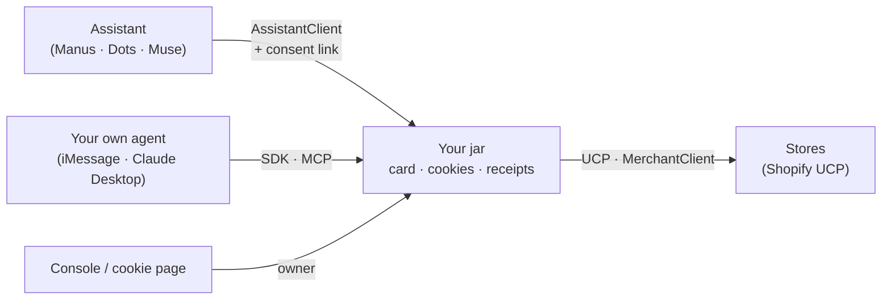

# Agent Cookie

**The next agent already knows you.** Agent Cookie is the layer that lets an agent you have never used know you before its first reply, with only the context the current task allows, a receipt for every release, and a revoke button that works.

> 中文版 README：[README.md](README.md)

---

## The problem

There are now more agents than anyone can onboard to. Every new assistant opens with the same interview: your language, your size, your style, the brands you avoid. Every new store asks again at checkout. People don't fill these in; they churn to the next agent and start from zero.

Websites solved a version of this decades ago with the cookie: a small, scoped memory that lets a site recognise you without asking again. Agents have nothing like it. What they have instead is either amnesia, or one company quietly keeping everything.

## What Agent Cookie does

Agent Cookie gives every person a **jar**, and three objects inside it.

| | What it is | What it guarantees |
| --- | --- | --- |
| **Identity card** | Agents contribute facts with provenance; deterministic rules merge them into fields. | What you said yourself counts at once. Learned preferences need independent sources, and stale ones decay. Guesses never reach the card. |
| **Conversation cookie** | Each merchant gets its own pairwise session ID and its own private note. | Stores get no shared identifier from us, so they cannot link you to each other through Agent Cookie. Switch personal agents and the same store still recognises you. |
| **Workspace** | Registers and matches agents, checks every read against policy, purpose, expiry and revocation, and writes a receipt. | No model can grant itself access. Authorization is code, not a prompt. |

## Two sides, one jar

Agent Cookie sits between two kinds of companies that never talk to each other.

- **Assistant companies** (think Manus, Dots, Muse) build personal assistants. They integrate `AssistantClient` and a one-tap consent link. On the first message they get the person's policy-allowed preferences, and they never carry the address or the card.
- **Commerce platforms** (Shopify and its stores) build shopping agents. They are reached by protocol (Shopify UCP today) or through `MerchantClient`. A store sees field names in the handshake, the size with the intent, and the address only at checkout, and only the store whose quote the person accepted.



The jar is also the only place that sees both sides of a purchase, so it can answer questions neither company can on its own: which assistant brings buyers who convert, which store wins quotes, and how many questions each person skipped. It reports counts only, with the person's consent.

## Rules we never bend

- **Deterministic authorization.** Field decisions, grants, expiry and merging are plain code. Models only classify text and write replies. A `userId`, `agentId` or `purpose` coming from a model is a parameter, never a permission.
- **No nodding required, a receipt every time.** Reads are checked against purpose and policy and released without bothering the person. Every release writes a receipt they can read.
- **The address goes to one store, at checkout.** It is released only to the merchant whose quote was accepted, only for the `checkout` purpose.
- **No card numbers, anywhere.** `payment_method` holds only a payment provider's token reference. It never reaches a merchant or an assistant, whatever they ask. The workspace authorizes payment itself, once, within budget.
- **Handshakes carry names, not values.** A merchant is told which fields exist before it is told what they contain.
- **Honest output.** Sample data is labelled Sample, recorded replays are labelled as such, and sold-out or `requires_escalation` results are told to the person as they are. No page or log shows an invented metric.
- **Revocation is real, within limits.** Revoking stops every future read at once. It cannot recall what a store already received, and we say so.

## Try it in five minutes

Local Sample mode needs no accounts: the workspace runs on a Sample person with recorded Shopify UCP responses. You need Node 22, Git and pnpm 9.12.

```sh
pnpm install --frozen-lockfile
pnpm build:deps

# Terminal 1: the real workspace, Sample seed, recorded UCP replay → 127.0.0.1:4310
AGENT_COOKIE_DEMO=1 AGENT_COOKIE_UCP=fixture pnpm workspace

# Terminal 2: an assistant company end to end (register → consent → context → find → accept → stats)
AGENT_COOKIE_URL=http://127.0.0.1:4310 AGENT_COOKIE_OWNER_KEY=ck_owner_sample \
  node examples/assistant-sdk/main.mjs
```

The Sample keys live in [`fixtures/dev-keys.json`](fixtures/dev-keys.json) and load only in demo and test mode. The example prints ids, counts and field names. The only values it shows are in the prompt block the assistant's own model would read.

Run the whole suite with `pnpm test` and `pnpm typecheck`.

## Integrate in a dozen lines

`@agent-cookie/sdk` is the single integration surface: Node 22+, ESM, typed, no runtime dependencies.

```ts
import { AssistantClient, assistantPrompt, registerAgent } from '@agent-cookie/sdk';

const url = 'http://127.0.0.1:4310';
const { key } = await registerAgent(url, { name: 'Muse', category: 'assistant' });
const muse = new AssistantClient({ baseUrl: url, key });

const link = await muse.requestLink();          // the person approves once; nothing auto-approves
await muse.waitForLink(link.id);

const system = `You are Muse.\n\n${assistantPrompt(await muse.context())}`;  // what they already told their agents
const found = await muse.find({ text: 'trail running shoes under $150, size 42', kind: 'shoes' }, 'find-0001');
const result = await muse.accept(found.quotes[0].id, 'accept-0001');         // the store gets the address, not you
```

More doors, all generated from or wrapping the same contract:

| Door | For |
| --- | --- |
| [`packages/sdk`](packages/sdk) | `AssistantClient`, `MerchantClient`, `WorkspaceClient`, with three quickstarts |
| [`packages/sdk-python`](packages/sdk-python) | A Python client generated from the OpenAPI document, with the same method names |
| [`packages/contract/openapi.json`](packages/contract/openapi.json) | OpenAPI 3.1 for any other language |
| [`packages/mcp`](packages/mcp) | MCP over stdio for Claude Desktop, or Streamable HTTP on `127.0.0.1:4311` |
| [`packages/cli`](packages/cli) | `agent-cookie init` mints your own agent a key and prints it once |

## Hosted jars

Most people will never run a server, so [`apps/gateway`](apps/gateway) runs one real workspace process per person behind a passkey. The workspace is never multi-tenant: each person's data lives in their own instance and directory. An assistant company registers once at the gateway. When it asks for a consent link, the person taps it, signs in or up with a passkey, and approves. The assistant then receives that person's jar URL and a key that works in that jar only. The owner key of each jar never leaves the gateway, and the person's cookie page shows who knew what, with revoke and delete-my-data.

## What's in the repo

| Path | Role |
| --- | --- |
| `apps/workspace` | The workspace: Hono, SQLite for hot state, a Git memory repo for durable state |
| `apps/gateway` | Hosted jars: one workspace per person, passkeys, consent pages, cookie page, operator funnel |
| `apps/console` | The person's console: card with provenance, learned preferences, grants, receipts, revoke |
| `apps/channel-photon` | An iMessage personal agent on Photon |
| `packages/contract` | The frozen contract: types, field policy, endpoints, error codes, OpenAPI |
| `packages/rules`, `packages/memory-repo` | Merge rules, policy codec, and the Git memory repo (Agent Memory Repo format) |
| `packages/learn` | Opt-in preference learning: local filter, a gate model, an extractor model, then schema checks and merge rules |
| `packages/auth`, `packages/pay`, `packages/ucp` | Pairwise session keys and Visa Trusted Agent Protocol signatures, the payment stage, the Shopify UCP bridge |

## What's real today

We keep three kinds of evidence apart: automated tests, recorded live runs, and Sample or replay data. The full index is in [`docs/evidence`](docs/evidence/README.md).

- **Built and tested over HTTP.** The card, cookies, policy, purposes, expiry, revocation, receipts and idempotency. Assistant consent links and churn between two assistant companies. Hosted jars through the gateway. Owner-minted keys for your own agent. Purchase history as a policy category that is off for assistants by default.
- **Recorded live runs.** Real iMessage send, select and handoff through Photon. A natural phone conversation produced a single-source preference candidate after the inactivity window. Actual Claude Desktop MCP calls read the shared Sample card and returned live offers in English. See the [October 18 evidence](docs/hana-demo.md). The unmodified Cognition Agent Memory Repo skill read and wrote the same repository as the workspace in an earlier verified run.
- **Not claimed.** No real payment has been completed: checkout ends in a merchant handoff link. Visa has no sandbox for us, so the Visa Acceptance provider is checked offline, byte for byte, against Visa's official Node SDK. A deterministic local simulator verifies every request with that SDK's own code. The workspace does not route payments to it yet, so a simulated result is never shown as a Visa one. Recorded UCP responses do not prove current stock. Independent-machine reproduction and a continuous end-to-end phone recording are not established by the evidence here.

## Tracks

These are the tracks we are entering, with the scope we can show. None of it is a claim of a prize or of eligibility.

| Track | What we bring |
| --- | --- |
| **Applied Intelligence** | Opt-in learning with a `typesafe/jev-1.14` gate and `openai/gpt-oss-120b` extraction via OpenRouter, where rules, not models, decide promotion and access. Real models passed the six original scenarios on synthetic inputs. |
| **Photon** | A real iMessage shopping agent: a request, up to two offers, a choice, and a merchant handoff. |
| **Visa** | Trusted Agent Protocol interop with pairwise per-session keys, single-use and within-budget payment authorization in tests, a Visa Acceptance provider (HTTP Signature and JWT) matched byte for byte against Visa's official SDK, and a scripted simulator that verifies requests with the SDK's own code. |
| **Cognition** | Format interop with the stock Agent Memory Repo skill (A23), and Claude Code and Devin integration runs from our skill (A16). |
| **Paper** | A console that shows where every fact came from, who may read it, for what, until when, and how to revoke it. Screenshots are labelled Sample. |
| **Sentry** | Tracing and logs validated offline. Dashboard evidence from a live account is still planned. |

## Built with

TypeScript · Node 22 · Hono · better-sqlite3 · simple-git · React and Vite · Model Context Protocol · Shopify UCP CLI · Photon · @simplewebauthn · Visa Trusted Agent Protocol · OpenRouter · vitest · pnpm

## License

[MIT](LICENSE). The demo person, address and keys are Sample data, and recorded merchant responses are labelled with their capture time.
