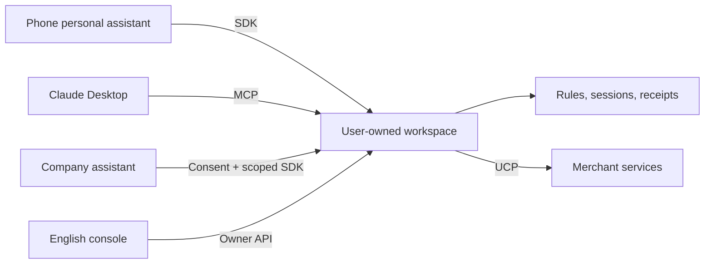

# Agent Cookie

**Switch assistants without starting over. Keep your context, permissions, and receipts in a workspace you control.**

Agent Cookie introduces connected assistants to the context they are allowed to use. Each merchant gets a stable, separate session; changing your personal assistant does not create a new merchant identity. Deterministic rules decide what can be read, for which purpose, and for how long. Every release creates a receipt.

## See the demo

- [English project story and submission answers](docs/devpost-submission-en.md)
- [English recording script and verified scope](docs/demo-script-en.md)
- [Phone, learning, handoff, and assistant-switch evidence](docs/hana-demo.md)
- [SDK integration guide](packages/sdk/README.md)
- [Assistant company example](examples/assistant-sdk/README.md)
- [Evidence index](docs/evidence/README.md)
- [Chinese technical guide](README.zh.md)

The English console shows context and its sources, learning candidates, connection requests, permissions, and receipts. A new company assistant connects through a consent link. Its context excludes shipping addresses and payment methods. Personal agents have a different trust role: do not describe their access as identical to company assistants.

## Run a local Sample

Use Node **22.12+ (22.x)**, Git, and pnpm. The local Sample requires no Photon or model account.

```sh
pnpm install --frozen-lockfile
pnpm build:deps
AGENT_COOKIE_DEMO=1 AGENT_COOKIE_UCP=fixture pnpm workspace
```

In another terminal, load only the public Sample owner key from `fixtures/dev-keys.json` into `AGENT_COOKIE_KEY`. The key stays on the console server; never use a `VITE_*` variable for credentials.

```sh
AGENT_COOKIE_SAMPLE=1 AGENT_COOKIE_URL=http://127.0.0.1:4310 \
  AGENT_COOKIE_SDK_ROOT="$PWD/packages/mcp" pnpm --dir apps/console dev
```

Open `http://127.0.0.1:5173/?mode=live`. Without `mode=live`, the console opens its local Sample preview. The preview and a connected workspace are labelled separately.

To try a company assistant, build the SDK and run `examples/assistant-sdk/main.mjs`. Set `AGENT_COOKIE_ASSISTANT_NAME=Muse` or another display name. Approve its request in **Connections**. The optional Claude greeting requires `ANTHROPIC_API_KEY`; without it, the example shows the actual context block rather than inventing a model response.

## What is real, and what is a Sample?

| Layer | Demonstrated scope |
| --- | --- |
| Workspace and permissions | Actual local HTTP service; deterministic authorization, expiry, revocation, and receipts. |
| Persona | Sample data is labelled. User evidence is preserved exactly. |
| iMessage | A real HANA/Photon conversation completed learning, shopping, and checkout handoff. See dated evidence. |
| Claude Desktop | Actual MCP calls read the same Sample card and returned live merchant offers in English. |
| UCP fixture mode | Replays recorded store responses; it does not prove current inventory or availability. |
| Live UCP mode | Searches live catalogs. Size, delivery, and checkout may remain unverified. A checkout URL is not a purchase. |
| Payment | No real payment is claimed. Visa interoperability evidence is offline; fake providers must stay labelled. |

The October 18 live HANA handoff did **not** release the Sample shipping address to a live store. Do not narrate it as an address-sharing demonstration. A controlled fixture checkout is a separate Sample scenario.

## Architecture



Pairwise IDs avoid exposing a single global workspace identifier to all recipients. They do not guarantee that recipients cannot correlate other information. Revocation blocks future access; it cannot recall data already delivered.

## Verification

```sh
pnpm typecheck
pnpm test
pnpm --filter @agent-cookie/console build
```

The Python SDK test package requires Python 3.11 or later. For TypeScript-only verification, run `pnpm -r --filter '!@agent-cookie/sdk-python' --if-present test` and report the Python suite separately. Live credentials and running demo data are excluded from Git.
