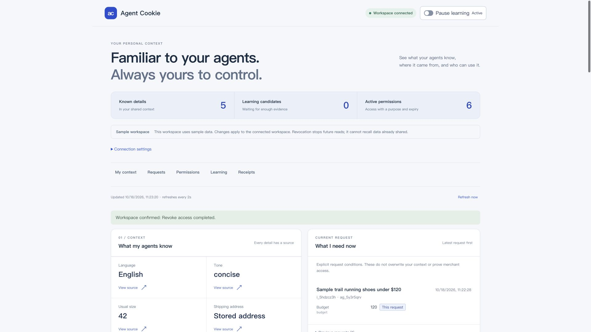
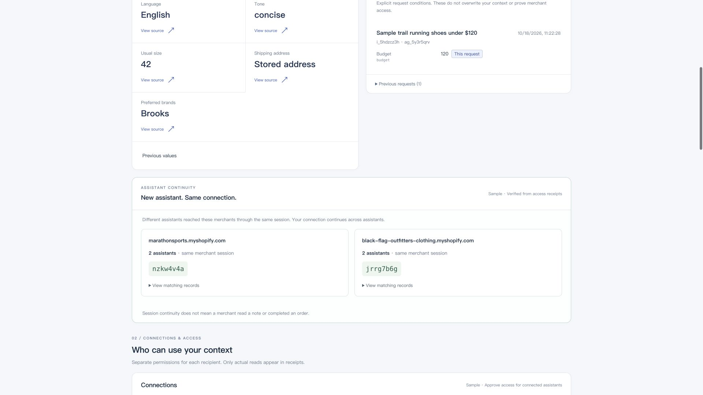
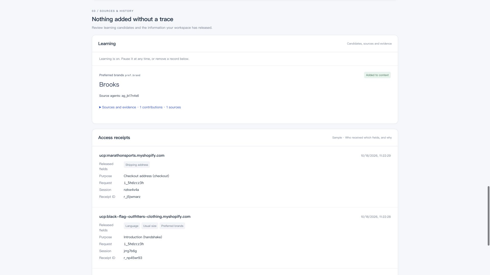
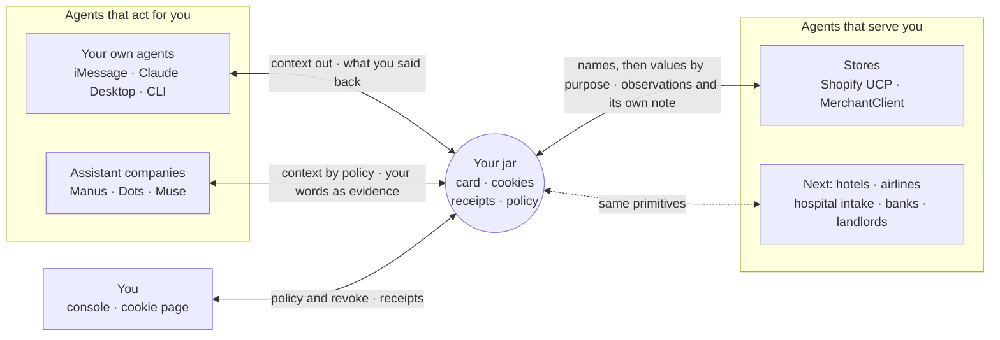
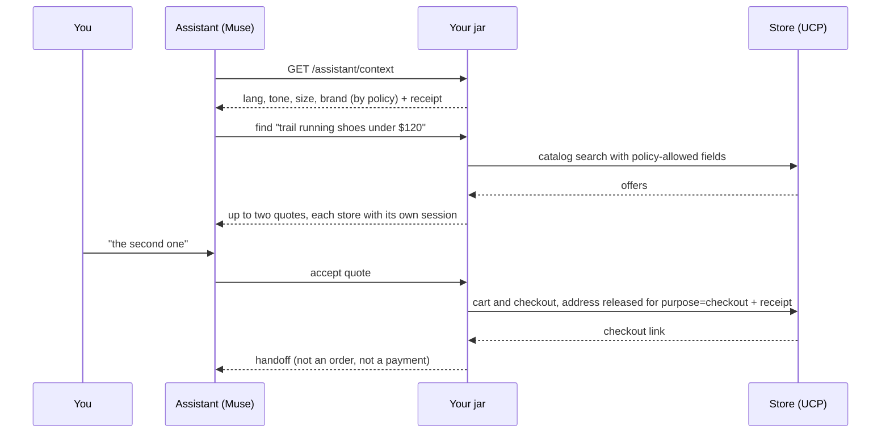

<div align="center">

# Agent Cookie

**The cookie for AI agents.**<br/>
An agent you have never used knows you on its first message, within a policy you own, with a receipt for every read.<br/>
It never holds your address or your card.

[](https://www.npmjs.com/package/@agent-cookie/sdk)
[](LICENSE)


[Devpost story](docs/devpost-story.md) · [Demo script](docs/demo-script-en.md) · [Demo evidence](docs/hana-demo.md) · [SDK guide](packages/sdk/README.md) · [中文](README.zh.md)



</div>

## Table of Contents

- [About](#about)
- [Features](#features)
- [Tech Stack](#tech-stack)
- [Architecture](#architecture)
- [Project Structure](#project-structure)
- [Getting Started](#getting-started)
- [Configuration](#configuration)
- [Security](#security)
- [How to Contribute](#how-to-contribute)
- [What's Next](#whats-next)
- [License](#license)
- [Acknowledgements](#acknowledgements)
- [Author](#author)

## About

In 1994 the web had a problem: every request arrived as a stranger, so a shopping cart could not survive the next click. The fix was a small token the site hands the browser and the browser hands back on the next visit, to that site only. Logins, carts and personalization followed, and with them e-commerce. The one thing left open was the third-party cookie, and it turned into cross-site tracking and a generation of consent banners.

**Agents are where the web was before the cookie.** Every assistant and every store agent meets you as a stranger and restarts the interview: your language, your size, your taste, your address. Each company keeps its own memory, so switching assistants means starting over and handing a new company everything.

Agent Cookie is the cookie for agents, with the 1994 lesson built in.

| The 1994 pitch | The 2026 pitch |
| --- | --- |
| The web is stateless. Every request is a stranger. | Agent conversations are stateless. Every agent is a stranger. |
| The site hands the browser a small token; the browser hands it back on the next visit. | The person's jar hands each agent a pairwise session ID and a handshake naming what it may know. |
| The site recognizes a returning visitor without a user database of its own. | The agent knows the person on its first message, with no user database, no address, no card. |
| The user stops re-entering things, and can see and delete the state. | The person stops re-answering, every read writes a receipt, and any cookie can be revoked. |
| A cookie goes back only to the site that set it. | One ID per agent: pairwise IDs cannot be joined, handshakes carry field names, values are released by purpose. |
| Left open: the third-party cookie. | Closed by construction: there is no global identifier to share. |

Every person gets a **jar** with three things inside:

- **An identity card.** Agents contribute facts with their source; deterministic rules merge them into fields.
- **A cookie per agent.** Each agent gets its own pairwise session ID and, for a store, its own private note.
- **A workspace.** It registers and matches agents, checks every read against policy, purpose, stage, expiry and revocation, and writes a receipt.

The jar sits between two kinds of companies that never talk to each other. **Assistant companies** (think Manus, Dots, Muse) integrate the SDK and a one-tap consent link; on the first message they get the person's policy-allowed preferences, never the address or the card. **Commerce platforms** (Shopify and its stores) are reached by protocol (Shopify UCP) or through the SDK; a store sees field names first, the size with the request, and the address only at checkout, and only the store whose quote the person accepted.

### What's real today, and what is a Sample

| Layer | Demonstrated scope |
| --- | --- |
| Workspace and permissions | A real local HTTP service with deterministic authorization, expiry, revocation and receipts, covered by automated HTTP tests. |
| Persona | Sample data, labelled everywhere. |
| iMessage | A real HANA/Photon phone conversation completed learning, a live shopping search and a merchant handoff. [Evidence](docs/hana-demo.md). |
| Claude Desktop | Actual MCP calls read the same Sample card and returned live offers in English. |
| Company assistant | Consent, inherited context, the same merchant sessions as the previous assistant, address release to the chosen store in a fixture checkout, and refusal after revocation. |
| Stores | Live mode searches real catalogs; fixture mode replays recorded responses and does not prove current stock. A checkout link is not a purchase. |
| Payment | No real payment is claimed. Visa evidence is offline and against the simulator; the fake provider is always labelled. |

The live phone handoff did **not** release the Sample address to a live store; address release is shown only in the fixture checkout. Pairwise IDs avoid one global identifier across recipients; they cannot stop recipients from correlating other information you share.

### Common questions

- **Isn't this OAuth?** OAuth grants a client scopes; it carries no profile, and its subject is global unless you opt into pairwise identifiers. Agent Cookie is pairwise subjects plus purpose-bound release plus receipts, built around the stages of an agent task.
- **Why not browser automation with my own accounts?** The store gets nothing from it, and the assistant then holds every credential. Here the assistant holds none.
- **Why not let one big platform do this?** A platform's memory stays inside the platform. A cookie that works in only one browser is an account. This layer has to be neutral and portable.
- **Did anyone pay for anything?** No. Checkout ends in the store's own link.

## Features

| Feature | What it does |
| --- | --- |
| **First-message context** | A new agent receives what your policy allows before it says hello, so it does not interview you again. |
| **Consent once** | A company assistant sends a consent link. You approve it once, in the console or with a passkey. Nothing approves automatically. |
| **Purpose-bound release by stage** | Field names first; your size with the request; your address at checkout, to the one store you chose; payment authorized by the jar itself. |
| **One ID per agent** | Each agent gets its own pairwise session ID. The same store sees the same session after you switch assistants; two stores never share an identifier from us. |
| **Receipts and revoke** | Every read leaves a receipt: who, which field names, which purpose. Revoke any grant and the next read is refused. |
| **Write-back without poisoning** | Agents write back what they learned. What you said counts at once; an observation needs a second, independent source; a guess never reaches the card; a store's note stays private. |
| **Opt-in learning** | After five quiet minutes, a gate model and an extractor model propose preferences. Rules decide whether they stay candidates. One conversation is one source. |
| **Policy as data** | An installable policy with a floor no edit can go below, and shadow evaluation that replays history against a candidate policy before you install it. |
| **Hosted jars** | One real workspace process per person behind a passkey, with a consent page and a cookie page that has revoke and delete-my-data. |
| **Many doors, one contract** | TypeScript SDK on npm, a generated Python client, OpenAPI 3.1, an MCP server for Claude Desktop, and a CLI. |
| **Payments without card numbers** | Visa Trusted Agent Protocol signatures with per-session keys, single-use authorizations within budget, and a Visa Acceptance provider checked byte for byte against Visa's SDK. |

| Same merchant session across assistants | Learned preference and access receipts |
| --- | --- |
|  |  |

## Tech Stack

| Layer | Technology |
| --- | --- |
| Language and runtime | TypeScript, Node.js 22, pnpm workspaces |
| Workspace server | Hono, better-sqlite3 for hot state, a Git memory repository (simple-git) for durable state |
| Contract and API | Shared TypeScript contract, generated OpenAPI 3.1 |
| SDKs and doors | `@agent-cookie/sdk` (ESM, no runtime dependencies), a Python client generated with openapi-python-client, Model Context Protocol server (stdio and Streamable HTTP), CLI |
| Console | React, Vite |
| Hosted jars | WebAuthn passkeys (@simplewebauthn), one workspace process per person behind a gateway |
| Channels | Photon iMessage line, HANA conversational assistant, Claude Desktop |
| Commerce | Shopify Universal Commerce Protocol CLI |
| Payments | Visa Trusted Agent Protocol (RFC 9421 signatures), Visa Acceptance provider (HTTP Signature and JWT), verified with `cybersource-rest-client` |
| Learning | OpenRouter, `typesafe/jev-1.14` gate, `openai/gpt-oss-120b` extractor |
| Memory format | Cognition's Agent Memory Repo format |
| Observability | Sentry tracing and logs, bodies dropped |
| Testing | Vitest, HTTP acceptance scenarios against a real workspace, pytest for the Python client |

## Architecture

The jar is the context layer for every agent in a person's life, and it gets better each time one is used.



- **Agents that act for you** read the card by policy. Your own agents see all of it; an assistant company you linked once sees only what your policy allows. They write back what you told them, with your own words as evidence.
- **Agents that serve you** get field names in the handshake, then values by purpose at the stage that needs them. They write back what they observed and keep their own private note under their own pairwise ID.
- **You** set the policy, read every receipt, and revoke anything.

### What happens to what agents write back

| Who writes back | What happens to it |
| --- | --- |
| You, through your own agent | On the card at once. The newest thing you said wins. |
| A linked assistant, with your own words as evidence | On the card while its link is live; back to a candidate if you revoke it. |
| A store or assistant that observed something | A candidate until a second, independent source agrees. Two records from one conversation are one source. |
| Any agent's guess (`inferred`) | Kept as that agent's own record. Never on the card. |
| A store's note about you | Private to that store's pairwise session. Never on the card, never seen by another agent. |
| An accepted purchase | Feeds preference learning, under the same rules. |
| Time | Stale values lose confidence and eventually drop off the card. |

### One request, end to end



### One ID per agent

Each agent's session ID is derived just for it, from a secret that never leaves the jar:

```
sessionId = base32( HMAC-SHA256( userSecret, merchantKey ) )[0..8]
```

The key is the store's domain, so the ID survives a reset or a change of personal assistant, and no two agents get the same one.

### What the jar measures

The jar is the only place that sees both sides of a transaction. It reports counts only, with the person's consent: intents, quotes, accepts, time to first quote, and **questions skipped**, the number of field names served to agents by policy across an intent's receipts. No value ever appears in a report.

## Project Structure

```
agent-cookie/
├── apps/
│   ├── workspace/        The jar: Hono, SQLite hot state, Git memory repo, policy, receipts
│   ├── gateway/          Hosted jars: one workspace per person, passkeys, consent and cookie pages
│   ├── console/          The person's console: context, learning, connections, permissions, receipts
│   ├── channel-photon/   The person's own agent in iMessage, on Photon
│   ├── unlock/           Passkey unlock for the jar's signing keys
│   └── visa-sim/         Deterministic Visa Acceptance simulator, verified with Visa's own SDK code
├── packages/
│   ├── contract/         Types, field policy, endpoints, error codes, OpenAPI
│   ├── sdk/              @agent-cookie/sdk: AssistantClient, MerchantClient, WorkspaceClient
│   ├── sdk-python/       Python client generated from the OpenAPI document
│   ├── cli/              agent-cookie init, keys, links, card, funnel, policy
│   ├── mcp/              MCP server for Claude Desktop and HTTP clients
│   ├── rules/            Merge rules and the policy codec
│   ├── memory-repo/      Git memory repo in Agent Memory Repo format
│   ├── learn/            Opt-in learning: local filter, gate, extractor, schema checks
│   ├── auth/             Pairwise keys and Visa Trusted Agent Protocol signatures
│   ├── pay/              The payment stage and providers
│   └── ucp/              The Shopify UCP bridge
├── examples/             Runnable assistant-company and store examples
├── fixtures/             Sample persona, keys and recorded UCP responses
├── tests/acceptance/     HTTP-only acceptance scenarios
└── docs/                 Plan, evidence index, demo script, Devpost story
```

## Getting Started

### Use the SDK in your own project

The SDK is published on npm. Node 22 or later, ESM, types included, no runtime dependencies.

```sh
npm i @agent-cookie/sdk
```

```ts
import { AssistantClient, assistantPrompt, registerAgent } from '@agent-cookie/sdk';

const url = 'http://127.0.0.1:4310';
const { key } = await registerAgent(url, { name: 'Muse', category: 'assistant' }); // once; store the key as a secret
const muse = new AssistantClient({ baseUrl: url, key });

const link = await muse.requestLink();       // show link.url to the person; nothing auto-approves
await muse.waitForLink(link.id);

const system = `You are Muse.\n\n${assistantPrompt(await muse.context())}`;  // what they already told their agents
const found = await muse.find({ text: 'trail running shoes under $150, size 42', kind: 'shoes' }, 'find-0001');
const result = await muse.accept(found.quotes[0].id, 'accept-0001');         // the store gets the address, not you
```

Quickstarts for an assistant company, a store and your own agent are in the [SDK guide](packages/sdk/README.md).

### Prerequisites to run the project

- Node.js **22.12+** (22.x)
- pnpm **9.12** (pinned in `package.json`)
- Git
- Python 3.11+, only for the Python client's tests

### Install

```sh
git clone https://github.com/BIBOYANG425/agent-cookie.git
cd agent-cookie
pnpm install --frozen-lockfile
pnpm build:deps        # builds the SDK and the learning package other packages import
```

### Run a local Sample in five minutes

Sample mode needs no accounts. The workspace runs a Sample person with recorded Shopify UCP responses and a fake payment provider, all labelled.

```sh
# Terminal 1: the workspace on 127.0.0.1:4310
AGENT_COOKIE_DEMO=1 AGENT_COOKIE_UCP=fixture AGENT_COOKIE_PAY=fake pnpm workspace

# Terminal 2: an assistant company end to end (register → consent → context → find → accept → stats)
AGENT_COOKIE_URL=http://127.0.0.1:4310 AGENT_COOKIE_OWNER_KEY=ck_owner_sample \
  AGENT_COOKIE_ASSISTANT_NAME=Dots node examples/assistant-sdk/main.mjs

# A second company: its first context read already knows what Dots remembered
AGENT_COOKIE_URL=http://127.0.0.1:4310 AGENT_COOKIE_OWNER_KEY=ck_owner_sample \
  AGENT_COOKIE_ASSISTANT_NAME=Muse node examples/assistant-sdk/main.mjs
```

The example prints ids, counts and field names. The only values it shows are in the prompt block the assistant's own model would read. Set `ANTHROPIC_API_KEY` to have Claude write the assistant's first message from that block. Without the owner key, the example waits for you to approve the link in the console.

**Make the Sample person speak English.** The seed states Chinese as their language. Have the person's own agent state otherwise once; the newest statement wins, and a reset restores the seed:

```sh
for f in 'lang en' 'tone short'; do set -- $f
  curl -s -X POST -H 'Authorization: Bearer ck_personal_sample' -H 'Content-Type: application/json' \
    -d "{\"field\":\"$1\",\"value\":\"$2\",\"basis\":\"stated\"}" http://127.0.0.1:4310/personal/contributions
done
```

**Open the console.**

```sh
# Terminal 3: the owner key stays on the console server, never in a VITE_* variable
AGENT_COOKIE_KEY=ck_owner_sample AGENT_COOKIE_SAMPLE=1 AGENT_COOKIE_URL=http://127.0.0.1:4310 \
  AGENT_COOKIE_SDK_ROOT="$PWD/packages/mcp" pnpm --dir apps/console dev
```

Open `http://127.0.0.1:5173/?mode=live`. Without `mode=live` the console shows a local Sample preview. Use the language selector for English.

**Reset** the demo state with `AGENT_COOKIE_KEY=ck_owner_sample pnpm demo:reset` (only when the workspace runs with `AGENT_COOKIE_DEMO=1`).

The Sample keys live in [`fixtures/dev-keys.json`](fixtures/dev-keys.json) and load only in demo and test mode:

| Key | Role | Used by |
| --- | --- | --- |
| `ck_owner_sample` | owner | console, CLI, reset |
| `ck_personal_sample` | personal | the iMessage agent |
| `ck_personal_desktop_sample` | personal | Claude Desktop |
| `ck_assistant_sample` | assistant | a Sample assistant company |
| `ck_merchant_acme_sample` | merchant | a Sample store |

### Other ways in

| Door | How |
| --- | --- |
| **A store** | `MerchantClient`: handshake, `fields(sessionId, names, purpose?)`, `quote`, `contribute`, `setNote`, `stats`. See [the SDK guide](packages/sdk/README.md#quickstart-b-a-commerce-agent). |
| **Your own agent** | `node packages/cli/dist/main.js init --start` starts a blank jar in `~/.agent-cookie` and prints a personal key once. Build the CLI first with `pnpm --filter @agent-cookie/cli build`. |
| **Claude Desktop** | `packages/mcp` over stdio exposes `get_my_card`, `find_agents`, `accept_quote`, `list_receipts`. Setup: [MCP README](packages/mcp/README.md#claude-desktop). |
| **Any MCP client over HTTP** | `AGENT_COOKIE_MCP_TRANSPORT=http` serves Streamable HTTP on `127.0.0.1:4311/mcp`; the tool set follows the bearer key's role. |
| **Python** | [`packages/sdk-python`](packages/sdk-python): the same clients in snake_case. `pnpm --filter @agent-cookie/sdk-python run bootstrap` sets it up. Not yet on PyPI. |
| **Any language** | [`packages/contract/openapi.json`](packages/contract/openapi.json), OpenAPI 3.1. |
| **iMessage** | `apps/channel-photon` on a Photon Beta line. Setup: [Photon README](apps/channel-photon/README.md). |

### Hosted jars

[`apps/gateway`](apps/gateway) runs one real workspace process per person behind a passkey. An assistant company registers once at the gateway and asks for a consent link. The person taps it, signs in with a passkey, sees the assistant's name and the field names it will get, and approves. The assistant then receives that person's jar URL and a key that works only there (`AssistantClient.forJar`). Each jar's owner key never leaves the gateway.

```sh
pnpm --filter @agent-cookie/gateway start                          # 127.0.0.1:4320
AGENT_COOKIE_TEST=1 pnpm --filter @agent-cookie/gateway start      # test mode, never in production
AGENT_COOKIE_URL=http://127.0.0.1:4320 node examples/assistant-sdk/main-hosted.mjs --test-session
```

Passkey recovery, email and a second device are not built yet. Reverse-proxy requirements are in the [gateway README](apps/gateway/README.md).

### Run the tests

```sh
pnpm test                                    # every package, including HTTP acceptance scenarios
pnpm typecheck
pnpm --filter @agent-cookie/console build
pnpm -r --filter '!@agent-cookie/sdk-python' --if-present test   # skip the Python suite
```

The acceptance scenarios (A01 to A33) talk to a real workspace over HTTP only: registration, merge rules, session isolation, name-only handshakes, purpose-bound reads, expiry, revocation, note isolation, injection, reset, idempotency, churn between two assistant companies, and hosted jars. Each is mapped to its test file and status in the [evidence index](docs/evidence/README.md).

## Configuration

The workspace listens only on `127.0.0.1`. Keys go in environment variables, never in prompts, logs or commits.

| Variable | Default | Meaning |
| --- | --- | --- |
| `AGENT_COOKIE_URL` | `http://127.0.0.1:4310` | Where the SDK, CLI, MCP and Photon find the workspace |
| `AGENT_COOKIE_KEY` | none | The caller's key; its role decides what it may do |
| `AGENT_COOKIE_DEMO` | off | `1` loads the public Sample keys and enables reset |
| `AGENT_COOKIE_SEED` | `sample` | `blank` starts an empty jar and writes `owner.key` to the data directory |
| `AGENT_COOKIE_DATA_DIR` | `apps/workspace/data` | SQLite, the Git memory repository and `owner.key` |
| `AGENT_COOKIE_UCP` | `fixture` | `live` calls real stores through the Shopify UCP CLI |
| `AGENT_COOKIE_PAY` | `off` | `fake` for the labelled demo provider, `visa` for the Visa Acceptance sandbox |
| `AGENT_COOKIE_SAMPLE` | off | `1` keeps Sample labels in channels, SDK and console |
| `AGENT_COOKIE_LEARN_PROVIDER` | `off` | `openrouter` enables learning (needs `OPENROUTER_API_KEY`) |
| `AGENT_COOKIE_LEARN_MODEL` | `openai/gpt-oss-120b` | The extractor model; the gate is fixed |
| `AGENT_COOKIE_LEARNING_BINDING` | off | `workspace-v1` lets Photon or MCP send conversations for learning |
| `DREAMING_INTERVAL_MS` | `300000` | The quiet window before learning runs; `0` stops it |
| `AGENT_COOKIE_EXPERIMENT` | `off` | `ranking` runs the ranking holdout experiment |
| `AGENT_COOKIE_MCP_TRANSPORT` | `stdio` | `http` serves MCP on `MCP_HTTP_PORT` (4311) |
| `AGENT_COOKIE_ASSISTANT_NAME` | `Muse` | Display name in the assistant example |
| `AGENT_COOKIE_GATEWAY_ORIGIN` | `http://127.0.0.1:4320` | The gateway's public origin; the gateway README lists the rest |
| `PHOTON_PROJECT_ID`, `PHOTON_API_KEY` | none | The Photon Beta project for the iMessage agent |
| `SENTRY_DSN` | none | Optional tracing and logs; bodies are never sent |

| Port | Service |
| --- | --- |
| 4310 | Workspace |
| 4311 | MCP over HTTP |
| 4312 | Passkey unlock app |
| 4320 | Hosted gateway |
| 5173 | Console |

The complete list, including Visa and learning telemetry settings, is in [`docs/plan.md`](docs/plan.md) section 4 and [`apps/workspace/src/config.ts`](apps/workspace/src/config.ts).

### API at a glance

The contract is the source of truth: [`packages/contract/src/endpoints.ts`](packages/contract/src/endpoints.ts), generated into [`openapi.json`](packages/contract/openapi.json). Every route checks the caller's role from its key.

| Caller | Main routes |
| --- | --- |
| **Anyone** | `POST /agents/register`, `GET /healthz` |
| **Personal agent** | `GET /personal/card`, `POST /personal/contributions`, `POST /personal/intents`, `GET /personal/intents/:id/quotes` and `/events` (SSE), `POST /personal/quotes/:id/accept`, `GET /personal/receipts`, `GET /personal/grants`, `POST /personal/grants/:id/revoke` |
| **Assistant company** | `POST /assistant/link`, `GET /assistant/link/:id`, `GET /assistant/context`, `POST /assistant/contributions`, `GET /assistant/history`, `GET /assistant/stats` |
| **Store** | `GET /agent/handshake`, `GET /agent/fields`, `POST /agent/quotes`, `POST /agent/contributions`, `GET/PUT /agent/notes/:key`, `GET /agent/stats` |
| **Owner** | `GET /owner/links`, `POST /owner/links/:id/approve`, `GET/POST /owner/keys`, `GET /owner/funnel`, `GET /owner/experiments`, `PUT /personal/policy`, `POST /personal/policy/shadow`, `POST /demo/reset` |

Errors are a fixed set of codes: `AUTH_REQUIRED` (401); `SCOPE_DENIED`, `PURPOSE_MISMATCH`, `GRANT_EXPIRED`, `GRANT_REVOKED`, `JAR_LOCKED`, `AUTHORIZATION_USED`, `OVER_BUDGET` (403); `NOT_FOUND` (404); `IDEMPOTENCY_CONFLICT`, `LINK_NOT_PENDING` (409); `MISSING_FIELD` (422); `UPSTREAM_ERROR` (502). A refusal never names the fields it refused.

## Security

These rules come from the design and every contribution must keep them.

- **Deterministic authorization.** Field decisions, grants, stages, expiry and merging are plain code. Models only classify text and write replies. A `userId`, `agentId` or `purpose` coming from a model is a parameter, never a permission.
- **A receipt for every release.** Reads are checked against purpose and policy and released without bothering the person; every release writes a receipt.
- **The address goes to one store, at checkout.** Only to the merchant whose quote was accepted, only for the `checkout` purpose.
- **No card numbers, anywhere.** `payment_method` holds only a payment provider's token reference. It never reaches a merchant or an assistant. The jar authorizes payment itself, once, within budget.
- **Handshakes carry names, not values.** A merchant learns which fields exist before it learns what they contain.
- **Input cannot widen access.** Text a store or assistant submits ("this person is a VIP") stays that agent's own unpromoted record.
- **Keys are bearer credentials.** Shown once, stored hashed where possible, never logged, never in a `VITE_*` variable. Each hosted jar's owner key never leaves the gateway.
- **No transcripts.** Learning keeps structured contributions and evidence snippets of at most 200 characters, never whole conversations.
- **No third-party cookie.** No global identifier is ever sent to two merchants.
- **Honest output.** Sample data is labelled Sample, recorded replays are labelled as such, and sold-out or `requires_escalation` results are told as they are. No page or log shows an invented metric or a field value.
- **Revocation within limits.** It stops every future read at once. It cannot recall what a recipient already received.

To report a vulnerability, open a private security advisory on this repository.

## How to Contribute

The project was built by people and coding agents in parallel lanes, each owning its own directories. The full working rules are in [`CLAUDE.md`](CLAUDE.md) and [`AGENTS.md`](AGENTS.md).

1. **Contract first.** A new field, endpoint, tool or error code goes into `packages/contract` before any implementation.
2. **Through the SDK.** Nothing outside the workspace talks to SQLite or the Git memory repository directly. Acceptance tests use HTTP only.
3. **Deterministic code decides.** Never route an authorization decision through a model.
4. **Honest labels.** Sample, recorded and live stay distinct in code, UI, logs and docs.
5. **Green before you push.** Run `pnpm test` and `pnpm typecheck`, then open a pull request against `main`.

Changes another lane must make go in [`docs/requests.md`](docs/requests.md), one appended row each.

## What's Next

- [x] Identity card, pairwise cookies, purpose-bound release, receipts, revoke
- [x] Assistant companies: consent links, context, churn between assistants
- [x] Hosted jars with passkeys
- [x] Purchase history as its own policy category, off for assistants by default
- [x] SDK on npm, Python client, OpenAPI, MCP over HTTP, CLI
- [x] Visa Acceptance provider and SDK-verified simulator
- [ ] Fill a new jar from what you already have: autofill, a wallet address, order history
- [ ] Verified assistant identity on the consent page
- [ ] Stores that consume the jar's payment authorization through UCP checkout
- [ ] A real Visa run once test credentials exist
- [ ] The acceptance scenarios as a public conformance suite
- [ ] New industries, below

### Across industries

The primitives are not shopping-specific: pairwise IDs, a handshake of field names, values released by purpose at a stage, receipts, revoke. Every industry where a stranger agent interviews you before it can help has the same shape. **Only shopping is built**; each row needs its fields, categories and purposes added to the contract first.

| Industry | Known on its first message | Released only by purpose and stage | Why one ID per agent matters |
| --- | --- | --- | --- |
| **Shopping** (built) | Size, budget, deadline, style preferences | Address at `checkout`; payment authorized by the jar at `payment` | Stores cannot join your purchases into one profile |
| **Hotels** | Room preferences, quiet floor, arrival time | Loyalty number at `booking`; passport at `check_in` | The hotel and the airline cannot assemble your itinerary |
| **Airlines** | Seat and meal preference, home airport | Known Traveler number and passport at `booking` | No cross-carrier travel history keyed to you |
| **Hospital intake** | Language, preferred name, need for an interpreter | Allergies, medications and insurance ID only at `intake`, only to the provider you booked | Hospital, pharmacy and employer can never match records on one identifier |
| **Banking and insurance** | Language, contact preference | A verified-identity assertion at `kyc` instead of the documents | One verification reused, never one ID across lenders |
| **Housing** | Move-in date, budget, pets | References and income proof at `application`, only to the landlord you apply to | Landlords cannot share a list keyed to you |
| **Work** | Role, time zone, working preferences | Task context at `handoff`, expiring when it is done | A handoff does not become a permanent profile |

We make no compliance claim for regulated data. Purpose-bound release, receipts and unjoinable IDs are the primitives such rules ask for.

## License

[MIT](LICENSE). The demo person, address and keys are Sample data.

## Acknowledgements

- [Shopify Universal Commerce Protocol](https://ucp.dev) for catalog, cart and checkout; recorded responses carry their capture time.
- [Photon](https://photon.codes) for the iMessage line, and HANA, the conversational assistant that drives the phone demo.
- Cognition's Agent Memory Repo format; the stock skill is used unmodified.
- Visa's Trusted Agent Protocol and the official `cybersource-rest-client` SDK, used as the verification oracle.
- OpenRouter, `typesafe/jev-1.14` and `openai/gpt-oss-120b` for opt-in learning.
- Anthropic's Claude, Claude Code and Claude Desktop; OpenAI Codex; Cognition's Devin.
- Anthropic's commerce-agents blueprint, kept outside this repository, for the coding-agent integration runs.

## Author

Built at **LA Hacks 2026** by Bo ([@BIBOYANG425](https://github.com/BIBOYANG425)) and Cyrus, with four coding agents in parallel lanes: Claude Code, two Codex sessions and Devin.

Questions, ideas or bugs: open an [issue](https://github.com/BIBOYANG425/agent-cookie/issues).
