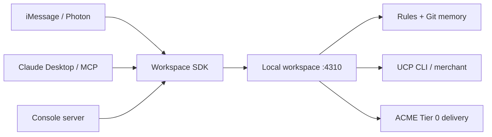

# Agent Cookie

让陌生 agent 在第一条消息之前认识你，同时只拿到当前任务允许的上下文。Agent Cookie 把 agent 写入的偏好合成身份卡，为每家商家派生独立 session，并管理字段授权、有效期、撤销和回执。

运行说明已同步 main `7beb63d`（#11 CI、#12 B 客户端、#13 可选 auth/TAP 接线已由人合并）；A15/A16 的实际取证基线仍为 `8c1a869`，不将后续代码变化混入旧记录。规格在 [plan.md](plan.md)，实际完成状态以[证据索引](evidence/README.md)为准。根 README 尚不存在，本文件可由根目录负责人链接。

## 当前交付

| 组件 | 入口 | 状态与边界 |
| --- | --- | --- |
| 工作台 | [apps/workspace](../apps/workspace) | 真实 rules、Git memory-repo、UCP adapter 已接入；默认 fixture 模式 |
| 身份卡与记忆 | [rules](../packages/rules)、[memory-repo](../packages/memory-repo) | 确定性合并、商家独立 session、Git 提交与 seed reset |
| 控制台 | [apps/console](../apps/console/README.md) | 卡片、授权、活动、reset；每 2 秒轮询，owner key 留在本机服务端 |
| SDK / CLI / Photon / MCP | [SDK](../packages/sdk)、[CLI](../packages/cli)、[Photon](../apps/channel-photon)、[MCP](../packages/mcp) | #12 已合入 main；MCP 仅 personal stdio，商家 MCP / HTTP 4311 尚未实现 |
| ACME retail | [blueprint](../examples/blueprint/README.md) | 外部克隆的原版通用商品 Sample 店；A15 首回、A16 安装分别留证 |
| TAP 签名 | [互通证据](evidence/2026-10-17-tap-interop.md) | 库级互通已有记录；#13 已接入可选握手 / 出站 TAP 签名及 unlock，签名异常仍可能无签名投递；不等于真实商家签名或支付验收通过 |

自动验收由 A 线 [apps/workspace/test/acceptance](../apps/workspace/test/acceptance) 维护，报告 P0 自动项 **66/66**。A10/A17 手动证据和源码中 A18 的未录制失败路径仍需独立核对，不能将该数字称为完整 P0 全绿。C14 只收集手动证据，不在 `tests/acceptance` 重写自动测试。

## 启动

需要 Node **22.19+，保持 22 系列**、pnpm、Git；blueprint 另需 Python 3.11+。从仓库根目录运行：

```sh
pnpm install
```

根 `package.json` 目前没有 `dev`。计划中的 `pnpm dev` 统一入口待根目录负责人接入；下面使用已有脚本分终端运行。

终端一，真实工作台使用独立演示数据目录：

```sh
export AGENT_COOKIE_DATA_DIR="$(mktemp -d "${TMPDIR:-/tmp}/agent-cookie-demo.XXXXXX")"
export AGENT_COOKIE_DEMO=1
export AGENT_COOKIE_UCP=fixture
export OPT_OUT_INSTRUMENTATION=true
pnpm workspace
# http://127.0.0.1:4310
```

终端二，在本机环境设置 `AGENT_COOKIE_KEY` 为 **owner** key 后启动控制台：

```sh
export AGENT_COOKIE_SAMPLE=1
pnpm --dir apps/console dev
# http://127.0.0.1:5173 → “连接本机工作台” → “连接”
```

演示模式可使用 `fixtures/dev-keys.json` 的公开 Sample owner 项；Photon / Desktop 的 personal key 不能代替 owner。控制台不使用 `VITE_*` key，也不把 key 送到浏览器。SDK 未安装时，仅缺失方法走标有 `TODO(sdk)` 的 HTTP 临时通道；也可将 `AGENT_COOKIE_SDK_ROOT` 指向仓库外已构建的 B 线运行目录。B 最新 SDK 已实现全部 C10b 方法。接入前需构建 SDK 并保证控制台能解析该包；当前 console manifest 尚无 SDK dependency，不能假设普通 pnpm 安装会建立链接。临时使用 `AGENT_COOKIE_SDK_ROOT` 时，该运行根须实际包含 `node_modules/@agent-cookie/sdk/dist/index.js`，配置后重启控制台。

在同一 owner 环境重置演示：

```sh
pnpm demo:reset
```

该命令调用 `POST /demo/reset`，清除演示状态并将专用记忆库恢复到 fixtures seed。不要与正在进行的聊天、验收或录制并行运行。`MEMORY_REPO_PATH` 只能指向工作台专用目录。

### iMessage 与 Claude Desktop

B 客户端已合入 main。以下命令在包含该合并的 checkout 中运行，无需切换 C 线开发分支：

```sh
pnpm --filter @agent-cookie/sdk --filter @agent-cookie/mcp --filter @agent-cookie/channel-photon build
pnpm --dir apps/channel-photon check
pnpm --dir apps/channel-photon start
```

按 [Photon 配置说明](../apps/channel-photon/README.md) 准备 `.env`，使用 `sample-personal-photon` 对应的 key。当前识别固定主线：“身份卡”“帮我找双越野跑鞋，120以内，周五前到”“要第二双”“回执”；是确定性文本识别，不宣称任意自然语言理解。手机实际收发以 B 线 A17 证据为准。

Claude Desktop 使用独立的 `sample-personal-desktop` key。在 `packages/mcp/.env` 设置 `AGENT_COOKIE_URL`、`AGENT_COOKIE_KEY`、`AGENT_COOKIE_SAMPLE`。保留现有配置中的其他 servers，加入：

```json
{
  "mcpServers": {
    "agent-cookie": {
      "command": "/absolute/path/to/node22",
      "args": [
        "--env-file=/absolute/path/to/agent-cookie/packages/mcp/.env",
        "/absolute/path/to/agent-cookie/packages/mcp/dist/main.js"
      ]
    }
  }
}
```

替换为本机绝对路径并重启 Desktop。工具为 `get_my_card`、`find_agents`、`accept_quote`、`list_receipts`；A10 需真实 Desktop 调用与工作台日志，stdio 测试不能替代。见 [MCP README](../packages/mcp/README.md)。

### UCP 与 ACME

```sh
export OPT_OUT_INSTRUMENTATION=true
npm i -g @shopify/ucp-cli@0.9.1
ucp profile init --name agent

# 第三方代码保留在仓库外，固定上游版本：
bash examples/blueprint/setup.sh
bash examples/blueprint/run.sh
# 另一终端核验 API / UI：
python3.11 examples/blueprint/verify.py
```

工作台 UCP 包锁定 CLI 0.9.1；使用不同全局版本前先核对 schema。`fixture` 重放已录制响应，`live` 请求当时商家状态。现有 pin pair 为 Marathon Sports / Black Flag，库存、价格只代表采集时刻；没有可靠 ETA 时显示“到货时间待确认”。见 [UCP 实录来源](../fixtures/ucp/README.md)。

ACME API/UI 为 8000/3000，真实聊天需 `ANTHROPIC_API_KEY`；health/catalog 成功不证明聊天成功。原版是通用商品 Sample 店，不能称为真实鞋店。A15 要保存工作台 Tier 0 投递后真实首条回复出现 42 码的证据；A16 要分别保存 Claude Code 与 Devin 从干净克隆开始的 skill 运行及录屏，完成前不宣称深度接入通过。

## 环境变量

| 名称 | 使用者与含义 |
| --- | --- |
| `AGENT_COOKIE_URL` | SDK / CLI / MCP / Photon 默认 `http://127.0.0.1:4310`；控制台固定此本机地址 |
| `AGENT_COOKIE_KEY` | 当前调用者 key：控制台 owner；Photon / Desktop 各自 personal key |
| `AGENT_COOKIE_DEMO` | 工作台设 `1` 开放 reset 与公开 Sample keys |
| `AGENT_COOKIE_TEST` | 仅验收设 `1`，开放 `/test/clock` |
| `AGENT_COOKIE_UCP` | `fixture`（默认）或 `live` |
| `AGENT_COOKIE_DATA_DIR` | 运行目录，默认 `apps/workspace/data` |
| `MEMORY_REPO_PATH` | 专用 Git 记忆库，默认数据目录下 `memory` |
| `SQLITE_PATH` | 默认数据目录下 `workspace.sqlite`；客户端不直读 |
| `FIXTURES_DIR` | 默认仓库 `fixtures` |
| `PORT` | 工作台默认 4310，host 固定 127.0.0.1 |
| `UCP_BIN` | 可选 UCP executable，未设置时使用 UCP 包的 CLI |
| `OPT_OUT_INSTRUMENTATION` | UCP CLI 设 `true` |
| `AGENT_COOKIE_SAMPLE` | SDK / 通道 / 控制台标示 Sample，`1` / `0`；不改变授权 |
| `AGENT_COOKIE_SDK_ROOT` | 控制台可选仓库外 B SDK 运行目录；控制台能解析已构建 SDK 后无需设置 |
| `PHOTON_PLATFORM` | 当前为 `imessage` |
| `PHOTON_PROJECT_ID` / `PHOTON_API_KEY` | Photon 项目与凭据，放本机 `.env` |
| `PHOTON_TEST_SENDER` / `PHOTON_AGENT_HANDLE` | B 线允许的测试发送者与 agent handle |
| `AGENT_COOKIE_CHANNEL_STATE` | 可选 Photon 持久状态文件；同一线路不并行启多个状态实例 |
| `ANTHROPIC_API_KEY` | ACME 真实模型；当前 Photon 主线不调用 LLM |
| `BLUEPRINT_DIR` / `BLUEPRINT_PYTHON` | 外部 blueprint 路径与 Python executable |
| `AGENT_COOKIE_JAR_KEK` / `AGENT_COOKIE_UNLOCK_SECRET` | D 线 jar / unlock 配置；工作台同时设置两者才启用可选 auth hooks，支付授权尚未接线 |
| `STRIPE_SECRET_KEY` / `SENTRY_DSN` | P1 支付测试 / tracing，设置变量本身不构成完成证据 |

端口：工作台 4310、控制台 5173、ACME API/UI 8000/3000，第二份 Sample 店 8001/3001。MCP HTTP 4311 是计划项；unlock 4312 独立验证，不作为已完成主线。

## 验证与提交材料

```sh
pnpm --filter @agent-cookie/workspace test -- test/acceptance
pnpm --filter @agent-cookie/rules test
pnpm --filter @agent-cookie/memory-repo test
pnpm --dir apps/console test
pnpm --dir apps/console build
node fixtures/verify.mjs
node fixtures/ucp/verify.mjs
```

以上是复跑命令，不是本文更新时重新执行的成绩。A 线维护自动结果；[手动索引](evidence/README.md)记录 A10/A17（B）、A15/A16（C）。C11 因 note 枚举、删除、clear 契约缺失保持 **P1 BLOCKED**。控制台真实来源列表仍缺逐条 contribution ID，不能用 Sample 撤销代替。

提交入口：[Devpost 草稿](devpost-draft.md)、[视频分镜](video-storyboard.md)、[证据索引](evidence/README.md)、[跨线请求](requests.md)。视频、说明、代码必须使用相同能力边界。

## 架构与第三方资产



主要依赖：TypeScript / Node、pnpm、Hono、SQLite（better-sqlite3）、simple-git、React / Vite、Vitest；B 使用 Photon API、Socket.IO、MCP SDK；商家访问使用 Shopify UCP CLI。ACME 来自 [Anthropic 固定提交](https://github.com/anthropics/commerce-agents/tree/fd4d59224ab96b43c6dc6888207c67b3bd5a24cf)，保留外部克隆，不把上游代码和 Sample 商品算成本项目新建。D 线另含 SimpleWebAuthn 与 Stripe，按实际展示范围披露。

`docs/plan.md` 与 `fixtures/` 按计划作为赛前材料披露。身份、地址、keys、ACME 商品均为 **Sample**；真实 UCP 响应副本按采集时间标 **Fixture replay**。已有执行片段标 **Recorded run** 并保留对应日志，不能冒充当前库存或现场响应。不要把 Sample 地址送给真实商家，不把付款链接称为已付款或已下单。`CARD.md` 由规则生成，不手工编辑。
