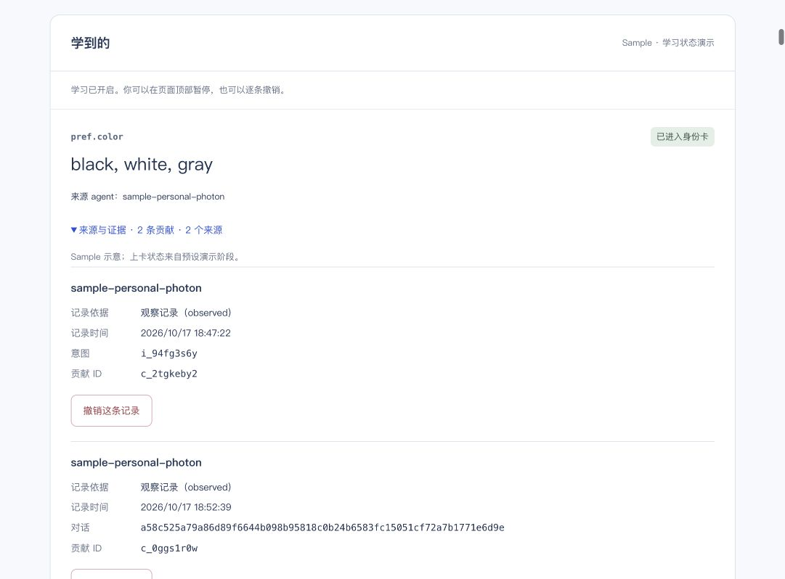

# Phone → idle queue → real models → console, 2026-10-17

## Current result

The corrected second real phone message completed its natural idle wait. It produced **no new contribution**, because the real Jev gate did not produce an eligible stable/whitelisted preference. It was not misrouted as shopping and did not duplicate a source. This is a verified gate-stop case, **not** a successful single-source candidate acceptance. Details follow the first-run history below.

## First run: result and limit

The original Photon **2.0 Beta** iMessage line received the user's real non-sensitive preference, queued it via the SDK, and automatically wrote a conversation contribution after **5 min 19.209 sec**. OpenRouter's rendered Logs table independently shows **Jev 1.14 (TypeSafe)** and **gpt-oss-120b (Baseten)** at 18:52 PDT. The connected console displays the same conclusion, contribution ID and conversation ID returned by the actual SQLite backend.

**This is a partial acceptance, not a clean one-message candidate/promotion success.** Before the idle timer, the old reply classifier incorrectly treated the casual clothing sentence as shopping and created an intent. That immediate intent learned the same value. The later conversation contribution then supplied a second source ID for the **same utterance**, incorrectly promoting it. Do not present this screenshot as two independent conversations confirming a preference.

## Observed timeline (PDT)

| Time | Actual observation |
|---|---|
| 18:47:21.157 | `observation.queue`, one user turn; HTTP 202 followed at 18:47:21.164. Channel logs show queued → accepted. |
| 18:47:22.776 | Unwanted shopping-path contribution `c_2tgkeby2`, source intent `i_94fg3s6y`, basis observed, value `black, white, gray`; initially candidate. |
| 18:51:57 | Readback still has only the intent contribution. No conversation learning before the five-minute idle threshold. |
| 18:52:39.786 | Scheduled conversation contribution `c_0ggs1r0w`, basis observed; no manual flush or clock adjustment. |
| 18:52:40.366 | `learn.apply`, object conversation, written=1, field pref.color. |
| 18:52:40.632 | Dreaming completed; compact remains skipped because the C implementation is absent in this runtime. |
| 18:53 | Console and SDK readback agree; the two source IDs incorrectly promote the single utterance, as described above. |

The runtime used the same persistent demo data and original cursor/outbox. A full ignored local data backup was made before activating learning. The backend was not restarted during the five-minute wait. The single channel listener was gracefully restarted after all eight outgoing records were sent to load the routing fix; cursor 8427 and all records remained. At this first-run snapshot, no second message had yet been requested. A later corrected run is recorded below. Commerce remains fixture; no purchase/payment occurred.

## Real model evidence

Read-only OpenRouter Logs at 18:52 PDT show Jev input/output 544/127 tokens and gpt-oss input/output 445/147 tokens, with gpt-oss finish reason `stop`. Displayed costs are $0.0000228 + $0.000118 ≈ **$0.0001408** for the scheduled pass. These are rounded UI values, not an invoice. The table does not expose an HTTP code in this view; do not invent one. Both models also ran for the earlier erroneous intent at 18:47. No extra probe or replay was sent to a model during this investigation. Original message text, credentials and full model request/response bodies are not included in this evidence.

## Fix and verification

`6e30ae6` removes the product-noun/habitual-verb shopping fallback. Casual product preferences now receive a deterministic acknowledgment. A shopping request requires a request/imperative clause; an explicit request following a preference clause still works. Beta shopping requests use the existing intent learner and are not also queued as an independent observation source.

The added regression failed before the fix, then passed. **89 channel tests, channel typecheck and build passed.** PR #26/main `82b6864` was merged into B without changing A source. At the initial evidence commit, no corrected phone rerun had occurred. The later run below verifies routing but stops at Jev; it is not mislabeled as a second positive live success. The prior incorrect intent/contribution remain as evidence; they were not silently deleted. A/C should define correction without treating a routing error as a user privacy revocation (which may suppress future learning of the same value).

## UI boundary and remaining work

The console is connected to the real local workspace, using its configured owner bridge. Its Sample labels refer to the fixture-backed demo account. C currently also prints “上卡状态来自预设演示阶段” in this live view; that text is misleading for actual learned contributions and needs correction. At the first-run snapshot B60 was pending. A PR #27 and B 0150264 now implement the formal contract/SQLite/SDK handoff; C Git codec and display remain pending. The running backend was not restarted during the second message wait, and old records are not retroactively labeled. Neither label is altered for the screenshot.

Machine-readable metadata and screenshot digest: `2026-10-17-phone-learning-live.json`.

## Corrected second phone run (18:55–19:03 PDT)

- Owner's distinct real, non-sensitive preference arrived at Photon **18:55:30.608**, and workspace `observation.queue` / HTTP202 recorded it at **18:55:30.974**, event IDs **12414 / 12415**. The preference concerns garment choice (shorts over trousers); no complete original sentence is reproduced here.
- At **18:59:40.973**, the learned list still contained only the first run's two old color contributions. No premature new entry or shopping-intent evidence appeared.
- The natural scheduled Dreaming run completed at **19:00:39.097**, event **13030**, approximately **5m08.123s** after queuing. OpenRouter's rendered Logs table shows one **Jev 1.14 / TypeSafe** request at **19:00**, 545 input / 127 output tokens, displayed cost **$0.0000229**, routing 0.14s and TTFT 0.07s. No extractor row appeared for this pass.
- Readback at **19:00:56.090** still contains only the two old color contributions. Channel cursor **8515**, nine message records, all sent. No new intent, contribution or duplicate source was produced by this message. No manual flush, clock advance, reset or backend restart occurred.
- A separate **read-only diagnostic** at **19:02:39.241** evaluated this same authorized test input once, without writing it back or sending a message: local filter passed; Jev HTTP200 in **283ms**; learner result **not_stable**; zero extracted preferences; **no gpt-oss request**. OpenRouter also shows this separate 19:02 Jev call. Do not count it as the timer run or as a successful extraction.

The gate therefore stopped learning rather than silently failing to deliver a message. The current whitelist descriptions do not clearly represent garment type (shorts/trousers); `pref.fit` describes fit and `pref.style` describes visual style. The aggregated `not_stable` result does not reveal which individual confidence/key condition failed, so this report does not invent the raw Jev probabilities. A/C should define the intended field or explicitly extend an existing field's meaning before B changes the classification policy. B did not force the preference into fit/style, reduce confidence thresholds, replay it into the jar or ask the user to send another message.

Positive real phone learning remains partially accepted by the first run; the corrected single-source positive path still needs a supported-key message or an approved whitelist update. The original six real-model scenarios remain a separate successful test on synthetic inputs.
