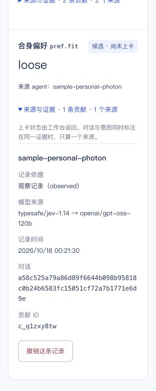

# C console integration and phone pause/forget acceptance

## UI integration — verified

- Human-merged C PR #28 is main `18188fd`; merged into B as `2b2598c`. The requests-file conflict retained both lines' appended history. Existing phone evidence was retained.
- The running Vite console picked up C's source changes and was explicitly reconnected to the existing localhost4310 workspace. The backend and unique Photon listener were not restarted. No preference, pause state or channel cursor was changed by this integration.
- The real `pref.fit=loose` candidate `c_q1zxy8tw` now displays **记录、来源与证据**, the workspace-derived status explanation, and **typesafe/jev-1.14 → openai/gpt-oss-120b**. The previous incorrect preset-learning copy is absent from this connected learning section. The overall Sample-workspace label still correctly indicates the fixture-backed account/commerce environment.
- Read-only baseline at `2026-10-18T07:30:41.082Z`: backend and local channel learning both enabled; two learned rows (old color, new fit), three contribution records; channel cursor12523, eleven sent messages. Fit remains one observed candidate, not a confirmed card value.

## Checks

- C console: all 57 tests passed across focused runs, test typecheck and production build passed. The initial sandbox run blocked nine bridge tests from opening localhost sockets (`EPERM`); those same nine passed when rerun with local-listener permission, without code/assertion changes.
- B phone controls, capture and Beta integration: 34 tests passed.
- There is no new workspace, contract, rules, memory-repo, SDK, learn or phone runtime source change in the main-to-B merge. Existing phone/backend state remains intact.

## Real phone steps — pending user input

1. User sends **暂停学习**. Require matching new phone processing, backend `paused:true`, local capture paused, and console paused state. Existing fit/color preferences must remain.
2. Only after step1 readback, user sends **忘掉 版型**. The current target is the single `pref.fit=loose` candidate. Require the actual forget result, disappearance from current learned/card/candidates, preserved unrelated color, and learning remaining paused. Do not claim old Git history was erased (`historyErased:false`).

The first phone instruction has been issued. Neither real pause nor real forget is marked passed yet. No API mutation has been performed on the user's behalf to simulate either command.

UI limitation retained for C: legacy rows without `models` currently render “本地规则”; missing metadata alone does not prove that an old record came from local rules. This does not affect the new fit row, whose two actual model IDs are present.

