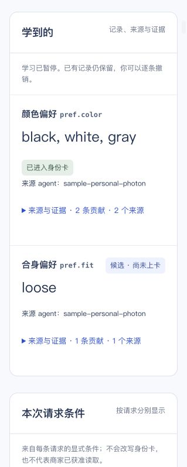
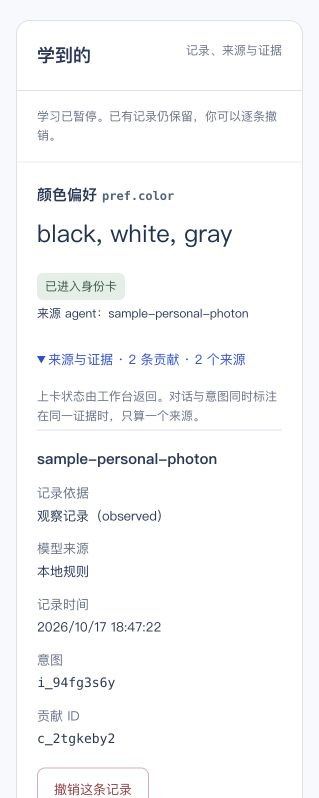

# C console integration and phone pause/forget acceptance

## UI integration — verified

- Human-merged C PR #28 is main `18188fd`; merged into B as `2b2598c`. The requests-file conflict retained both lines' appended history. Existing phone evidence was retained.
- The running Vite console picked up C's source changes and was explicitly reconnected to the existing localhost4310 workspace. The backend and unique Photon listener were not restarted. No preference, pause state or channel cursor was changed by this integration.
- The real `pref.fit=loose` candidate `c_q1zxy8tw` now displays **记录、来源与证据**, the workspace-derived status explanation, and **typesafe/jev-1.14 → openai/gpt-oss-120b**. The previous incorrect preset-learning copy is absent from this connected learning section. The overall Sample-workspace label still correctly indicates the fixture-backed account/commerce environment.
- Read-only baseline at `2026-10-18T07:30:41.082Z`: backend and local channel learning both enabled; two learned rows (old color, new fit), three contribution records; channel cursor12523, eleven sent messages. Fit remains one observed candidate, not a confirmed card value.

## Checks

- C console: all 57 tests passed across focused runs, test typecheck and production build passed. The initial sandbox run blocked nine bridge tests from opening localhost sockets (`EPERM`); those same nine passed when rerun with local-listener permission, without code/assertion changes.
- B phone controls, capture and Beta integration: 34 tests passed.
- There is no new workspace, contract, rules, memory-repo, SDK, learn or phone runtime source change in the main-to-B merge. Existing phone/backend state remains intact.

## Real phone pause — verified

At **00:32:32.197 PDT**, the user's **暂停学习** command produced `learning.set` event17342 (`result:paused`) and `PUT /personal/learning` event17343 (HTTP200). The user confirmed receipt of “已暂停学习，后台已确认”. Readback at00:32:47 found backend `paused:true`, local capture `paused:true`, and all prior learned rows/evidence unchanged. The console switch was on and the learning section said “学习已暂停。已有记录仍保留”. Channel cursor advanced to12746, twelve sent outbox records. The control command did not create a learning observation or contribution.

## New preference while paused — verified

The user then sent the ordinary preference sentence again while learning was paused. The existing Photon listener reported `learning_capture: dropped, depth:0` and advanced to cursor12782 / thirteen sent records. Readback at **00:36:01.424 PDT** confirmed both pause flags remained true, all learned rows/evidence exactly matched the pre-message snapshot, and there was no new observation queue, contribution or learn-apply event. This verifies the actual paused phone-input path rather than only the switch display. The assistant did not call a model or re-submit that input.

## Real phone forget — verified

The user's **忘掉 版型** command produced `learning.forget` event20547 at **00:43:47.141 PDT** (`actor:sample-personal-photon`, `object:pref.fit`, `result:removed`, `count=1`), followed by `POST /personal/learning/forget` event20548 at00:43:47.552 (HTTP200). The user confirmed the success reply and that learning remains paused.

Read-only SDK verification at **00:45:38.277 PDT** found:

- `pref.fit=loose` and current contribution `c_q1zxy8tw` absent from learned records, card and candidates.
- Unrelated `pref.color=black, white, gray` and contributions `c_2tgkeby2` / `c_0ggs1r0w` exactly unchanged from the paused-input baseline.
- Backend and local capture both still paused; the Desktop personal key via SDK sees the same remaining learned records and no fit on its card/candidates. This is a cross-client SDK readback, not a new Claude Desktop UI run.
- Channel cursor12909, fourteen outbox records, all sent. No new learning observation, contribution, or shopping-intent activity from the delete command.
- The live console now shows only color in “学到的” and retains the paused notice. The screenshot expands the retained color evidence; full section inspection confirms the fit row is absent.

The assistant made only read calls during this acceptance; it did not invoke a delete endpoint to simulate the phone command. Current preference and evidence deletion is verified. **Old Git history is retained (`historyErased:false`)**, so this is not physical erasure of all historical versions.

**This acceptance is complete:** real phone learning → candidate visible in C console → pause → ordinary input dropped while paused → targeted forget with unrelated color preserved. Learning remains paused; no automatic resume was performed. [Machine-readable evidence](2026-10-18-phone-controls.json) records each stage separately. Recovery/resume on the actual phone, two independent-conversation promotion, and the separate merchant greeting are not claimed by this acceptance.

UI limitation retained for C: legacy rows without `models` currently render “本地规则”; missing metadata alone does not prove that an old record came from local rules. The fit record had both actual model IDs before the requested deletion, as preserved in the earlier acceptance evidence.

