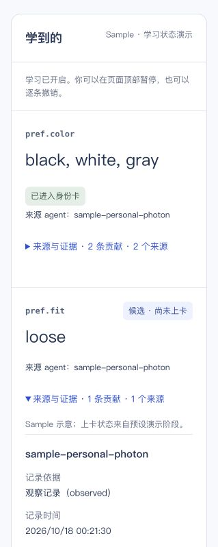

# Real phone → natural idle → preference candidate: passed

Runtime source gate `05a5d8f`, corresponding human-merged main `35e8b56`; B evidence baseline `c81378c`. This is the user's new, manually resent phone message, not a synthetic model input or replay of the sleep-interrupted attempt. Times below are Pacific time on October 18.

## Observed sequence

| Time | Evidence |
| --- | --- |
| 00:16:02.132 | One owner turn queued (`observation.queue` 14482), followed by HTTP 202 (14483). |
| Through 00:20:50 | Read-only polling found no new contribution before the five-minute idle boundary. |
| 00:21:30.287 | New contribution `c_q1zxy8tw` was created for `pref.fit = loose`, with `basis = observed`. |
| 00:21:30.856 | `learn.apply` 15289 reported `written=1`, `fields=pref.fit`. Queue-to-apply delay: **328.724 seconds / 5m 28.724s**. |
| 00:22:20 | A further polling interval still showed exactly one new contribution; no duplicate or new shopping intent. |
| 00:22:32 | The Desktop personal-agent identity independently read the same contribution through the SDK. It was in `candidates`, absent from the confirmed card. |

The connected console displayed **loose — 候选 · 尚未上卡**, one contribution, one conversation source, and the matching creation time. The prior color row and its two historical contributions were preserved; they do not count toward this new fit preference's confirmation.

## Actual models

The contribution's formal `evidence.models` contains `typesafe/jev-1.14` and `openai/gpt-oss-120b`. The refreshed OpenRouter Generations page showed exactly the two new generation rows at **00:21**:

| Model | Provider | Input / output tokens | Displayed cost |
| --- | --- | --- | --- |
| Jev 1.14 | TypeSafe | 923 / 127 | $0.0000388 |
| gpt-oss-120b | Groq | 436 / 121; finish reason `stop` | $0.000138 |

Displayed total: approximately **$0.0001768**. These are provider UI observations, not invented HTTP-status or total-latency claims. No additional diagnostic model request was made.

## Boundaries and remaining UI work

- No manual flush, reset, automatic replay, forced promotion, second phone listener or credential change was used. The user kept the laptop open; the existing temporary idle-sleep inhibitor remained active. Original channel state was retained (`cursor=12523`, eleven `sent` outbox records).
- This verifies one incidental preference becomes one candidate. Independent-conversation promotion, phone pause/forget, and a merchant's remembered greeting were not re-tested. The Desktop readback used its key via the SDK; it is not a new Claude Desktop UI acceptance.
- The current console still says “Sample · 学习状态演示” and “上卡状态来自预设演示阶段” for the connected fixture-backed workspace, and does not show model provenance. That is the already-reported C display issue, not the source of this new row. C `00e566d` has related UI changes, but those were not loaded during this acceptance. The SDK and actual OpenRouter generations establish that the new row came from real learning.
- The API omits the optional evidence snippet for this row; this report does not claim a measured snippet length. No full original utterance, credential, phone identity or complete model request is included.
- The earlier [sleep-interrupted attempt](2026-10-18-phone-gate-acceptance.md) remains recorded as not passed; this successful retry does not rewrite it.

Machine-readable checks and metadata: [JSON evidence](2026-10-18-phone-gate-retry.json).

