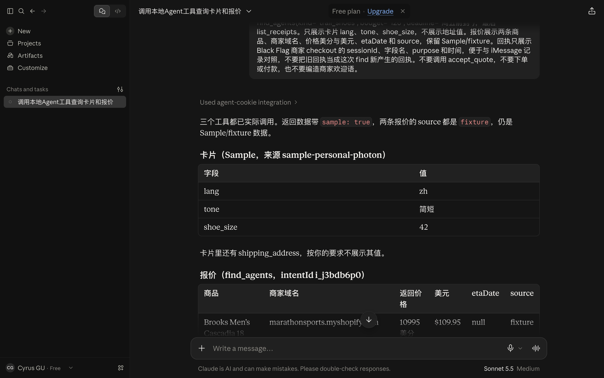
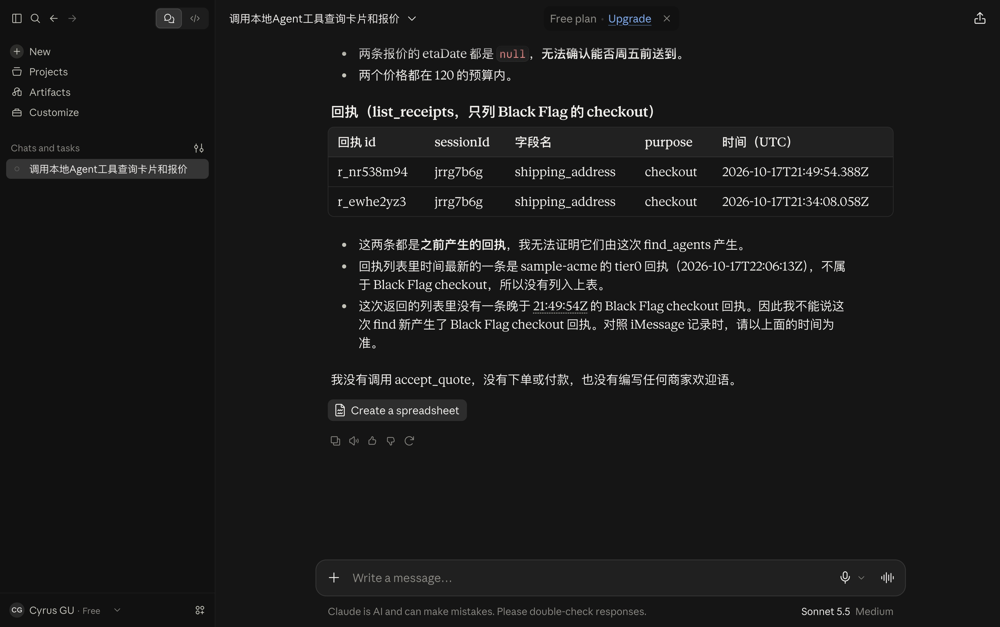
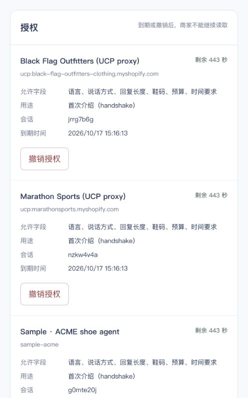
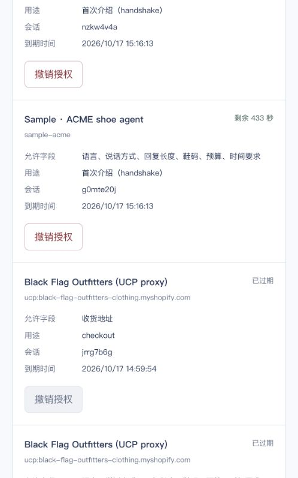

# A10 — real Claude Desktop / SQLite evidence index

**Passed on the recorded 2026-10-17 15:06 PDT baseline, commit `1352eff`.** This replaces the stale “not executed” template with the already captured evidence. It is not a new Desktop run on the current Dreaming build and is not live-model learning acceptance. No user was asked to repeat the successful calls.

| Item | Verified record |
| --- | --- |
| Client | Real Claude Desktop, local MCP stdio; user confirmed visible results |
| Trusted identity | `sample-personal-desktop`; credentials omitted |
| Backend | Same-machine 127.0.0.1:4310, SQLite + real rules + real Git memory-repo |
| UCP | `fixture`, Sample labels retained; not real-time inventory |
| `get_my_card` | 15:06:11 PDT, corresponding card HTTP 200 |
| `find_agents` | 15:06:13 PDT, corresponding intent 201 and quotes 200 |
| `list_receipts` | 15:09:31 PDT, corresponding receipts 200 |
| Provenance | [Protocol/backend JSON](2026-10-17-postmerge-b-verification.json) and [verification narrative](2026-10-17-postmerge-b-verification.md) |
| Version limits | Original evidence does not record an exact Desktop release or Node version; do not infer them from current installation |

The screenshot contains the Sample card, `find_agents` heading and the first $109.95 quote. The second $112.00 quote was below its viewport and was verified through native accessibility state and backend readback, not through this screenshot. Both returned `source=fixture`, `etaDate=null`. Card values are Sample data; address values are not shown.

## Beat 6: same store, same session

The Desktop lookup above and the iMessage checkout at 14:49:54 PDT refer to the same Black Flag merchant. Full session IDs were compared internally; matching SHA-256 fingerprints are recorded in the JSON. The actual console screenshots display the same short session `jrrg7b6g`:

These two screenshots are console evidence, not a merchant chat. This indexing pass verified all four image hashes against the recorded JSON and visually rechecked the card and grant images. The receipt itself remains an earlier handoff; Desktop did not make a new accept or payment.

**Still not passed:** merchant model reads its own note and produces a real returning-customer opening. At current B `20712a4`, `commerce.ts` writes `last_order` for both ordered and handoff results, but the find path has no corresponding merchant note-read/model opening. Handoff does not establish a purchased order. A should distinguish `last_handoff` from a completed `last_order` and supply the trusted same-merchant/session reading path; B must not simulate that greeting or combine ACME with Black Flag. See B56 and earlier B38/B40.
