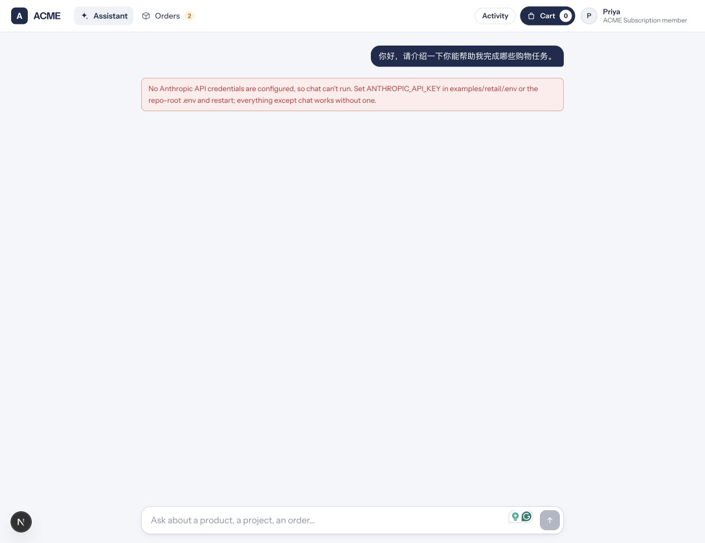

# A15 实际尝试：原版 ACME retail

> **已砍（Tier 0 协议不匹配，2026-10-17 决定）**。A15 不再出现在 demo；下文仅保留历史尝试。

状态：**BLOCKED / 未通过**。2026-10-17 已实际启动原版 API `:8000`、页面 `:3000`，并让新 main 的独立工作台 `:4318` 执行 Tier 0 投递。工作台生成了含 `shoe_size 42` 的前缀和一条回执，但原版 API 返回 401；没有首条 assistant 回复，不能提供“首条回复包含 42 码”的截图。

## 基线与隔离

| 项目 | 本次实际值 |
| --- | --- |
| 工作台 | `8c1a869fe9fc67c7d7a80dd09714d0a4d21b6954`，main，真实 rules / memory-repo / UCP adapter |
| B SDK | `04c6e108e43999a15cecf3093c45acd21673a74c`，从远端引用导出并构建 |
| ACME | `anthropics/commerce-agents@fd4d59224ab96b43c6dc6888207c67b3bd5a24cf` |
| 原版 clone | `/private/tmp/agent-cookie-commerce-agents` |
| 临时工作台根 | `/private/tmp/agent-cookie-a15-f4_1ai5k` |
| 工作台状态 | 新目录 `sample-data/`，`PORT=4318`、`AGENT_COOKIE_DEMO=1`、`AGENT_COOKIE_TEST=1`、`AGENT_COOKIE_UCP=fixture` |
| 数据 | 仓库内公开 Sample fixtures 的外部副本；原版通用商品不变 |
| 凭据 | 进程环境中的 Anthropic key / auth token / Claude OAuth token 均未设置；clone 根和 retail 均无 `.env`；未输出凭据值 |
| 未改动的服务 | 用户原有 `:4310` 和 `:5173` 保留；`:4310` 的旧 runtime 不是本次工作台 |

[baseline.json](baseline.json) 与 [after.json](after.json) 记录运行前后 commit、git 状态和关键上游文件 SHA-256；[upstream.diff](upstream.diff) 是真实的空 diff。运行结束取证时完整 `git status --porcelain` 为空。安装依赖及上游启动产生的 ignored runtime 文件不等于源码修改。未改商家 prompt、商品 catalog、API 或前端。

新工作台源码也按原提交逐文件比较，结果在 `after.json`。唯一额外取证手段为临时进程加载 [capture-tier0.mjs](capture-tier0.mjs)：包装 `fetch` 并原样委托，仅记录 `http://127.0.0.1:8000/api/chat` 的请求与响应；没有替换响应或修改目标。记录 header 名称，不记录任何凭据 header 值。

## 工作台真实投递

调用通过实际 B `WorkspaceClient` 完成：`getMyCard`、`createIntent`、`getActivity`、`getReceipts`。钥匙按角色从公开 `fixtures/dev-keys.json` 在进程内读取，未放进命令参数或输出。

`2026-10-17T21:48:24.822Z` 捕获到的请求为：

```http
POST http://127.0.0.1:8000/api/chat
Content-Type: application/json

{"session_id":"g0mte20j","message":"[agent-cookie] session g0mte20j · lang zh · tone 简短 · shoe_size 42 · budget 120 · on request: shipping_address(checkout)"}
```

原版响应：

```http
HTTP 401
Content-Type: application/json

{"detail":"Start a session first (POST /api/session)"}
```

完整证据在 [tier0-wire.jsonl](tier0-wire.jsonl)；[workspace-attempt.json](workspace-attempt.json) 保存 SDK 请求、Sample 来源、receipt `r_z3jje37d` 和活动 `tier0.deliver / failed / attempts=1 status=401`。上面的 `g0mte20j` 是公开 Sample 的工作台 pairwise ID，不是上游生成的聊天凭据。

实际前缀带 `lang`、`tone`、`shoe_size`、`budget` 的 auto 值；`shipping_address` 仅为用途字段名，Sample 地址值没有进入前缀。回执也仅包含字段名。检查结果见 [checks.json](checks.json)。**回执记录放行/投递尝试，不能证明商家聊天成功。**

失败机制可直接对应源码：工作台 `apps/workspace/src/services/delivery.ts:74–80` 发送 `{session_id,message}`，但上游 `examples/demo_common/storefront.py:192–206` 要求先 `POST /api/session`；`examples/demo_common/sessions.py:168–178` 随后从 `X-Session-Id` 解析上游随机凭据。当前工作台未建立这个映射，也未消费 SSE。请求 body 的 pairwise ID 不能代替 header。

## 独立正确协议诊断

为区分传输不兼容与模型凭据缺失，另运行一次原版协议诊断：先 `/api/session`，只在内存保留返回 token，再带 `X-Session-Id` 发送同一 Sample 前缀。此诊断没有接回工作台投递链路，**不是 A15 通过证据**。

[correct-protocol-probe.json](correct-protocol-probe.json) 的实际结果：

- health 200；catalog 200，87 个商品，标题中鞋类关键词匹配为 0。
- session 200，返回 subject 与工作台 Sample pairwise ID 一致；token 未记录。
- chat HTTP 200、`text/event-stream`，完整流只有 `error` 事件。
- `firstAssistantReply=null`，没有 `turn_complete`，没有包含 42 码的 assistant 回复。

另外通过原版 Chrome 页面发送一句独立的通用购物问候，页面真实显示 `No Anthropic API credentials are configured, so chat can't run.`。该 UI 会话是原版默认 Sample profile，不是工作台投递的会话；不能把两条路径拼成成功。



[original-storefront.jpg](original-storefront.jpg) 是发送诊断问候前的原版页面截图。两个 JPG 都由真实浏览器截图 API 取得，未重绘或编辑。**没有连续录屏，也没有“首条 assistant 回复包含 42 码”的截图。**

## 本次命令

最初执行本仓库 `run.sh` 时，旧外部 `.venv` 缺少 agent runtime、FastAPI、uvicorn、dotenv，且前端依赖未安装；启动器明确退出。随后按原版锁文件恢复依赖，未修改锁文件或源码：

```bash
cd /private/tmp/agent-cookie-commerce-agents
/opt/homebrew/bin/uv pip install --python .venv/bin/python --cache-dir /private/tmp/agent-cookie-c-uv-cache -r requirements.txt
cd examples
PATH=/private/tmp/agent-cookie-c-node22/node_modules/.bin:$PATH npm ci --registry=https://registry.npmjs.org --cache=/private/tmp/agent-cookie-c10b-runtime-rq8escjo/npm-cache --no-audit --no-fund --fetch-retries=1 --fetch-timeout=30000

cd '/Users/mac/LA Hacks 2026'
PATH=/private/tmp/agent-cookie-c-node22/node_modules/.bin:$PATH BLUEPRINT_DIR=/private/tmp/agent-cookie-commerce-agents bash examples/blueprint/run.sh

cd /private/tmp/agent-cookie-a15-f4_1ai5k
./start-workspace.sh
/private/tmp/agent-cookie-c-node22/node_modules/.bin/node attempt.mjs
/private/tmp/agent-cookie-commerce-agents/.venv/bin/python probe-storefront.py
```

依赖安装、端口监听和 localhost 探针在普通沙箱受网络限制后，使用获准的沙箱外执行。SDK 构建为 `node node_modules/typescript/bin/tsc -p packages/sdk/tsconfig.build.json`。本次没有运行全套测试、demo reset、checkout accept 或支付。

探针源码：[attempt.mjs](attempt.mjs)、[capture-tier0.mjs](capture-tier0.mjs)、[probe-storefront.py](probe-storefront.py)。它们记录此次临时环境路径；不是产品适配器或 SDK 新接口。

仍需解决：工作台与上游的 session/header/SSE 适配；可用的真实模型凭据；原标准要求的首条回复与连续录屏。原版没有鞋类，不能以替换 catalog 或改 prompt 的方式补成“零接入通过”。
