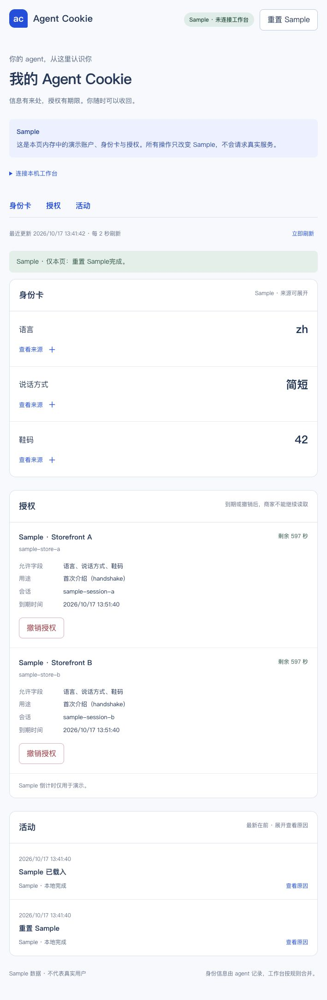

# C09 · Sample 身份卡

2026-10-17 在本机 Vite 控制台实际检查：三条 fixture 分别显示 `lang=zh`、`tone=简短`、`shoe_size=42`，每条可以展开来源 agent、依据、时间和贡献 ID。全页标明 Sample。

骨架与初版身份卡实现已提交于 `8606f9e`；本轮继续验证当前控制台。来源撤销后对应字段消失，焦点回到身份卡标题；撤销三条后的空状态有重置提示；重置恢复三条。此结果只证明 Sample 界面，不能作为 A14 的真实工作台来源撤销验收。

后续授权、活动、实时工作台和 320px 检查见 C10/C16 的证据。

2026-10-17 C23：本页保留历史截图；新版通用字段/本次条件/回执见 [当前控制台证据](console/README.md)。
