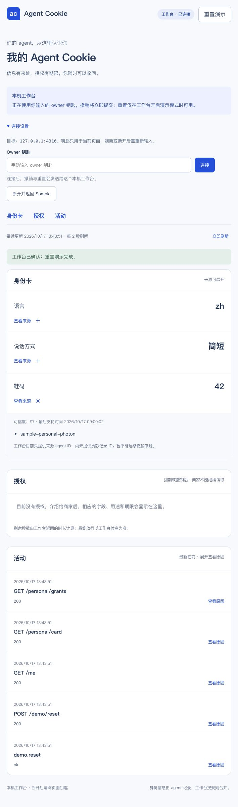

# C10 · 控制台授权、活动与重置

2026-10-17，Node 22.23.3，Vitest 2.1.9：**12 项测试通过，类型检查和 Vite 生产构建通过**。测试包含 2 秒轮询、无并发轮询、断开取消、旧响应不覆盖撤销结果、失败不报成功、服务器剩余时长、活动倒序及同毫秒事件的顺序。

浏览器实测：

- Sample 来源逐条撤销；三个字段全撤后显示空状态；reset 恢复三个字段。撤销后焦点在 `card-title`。
- 撤销 Sample A 授权后显示“已撤销”，B 的倒计时继续；活动有原因展开控件。
- 通过 Vite 的固定 loopback 代理连接 A `bd9d6e3` 原版工作台，读取真实 HTTP 返回的 card、grants 和 activity；撤销一条测试授权后显示已撤销，另一条保留。
- 点击真实“重置演示”后，工作台确认，三条种子身份卡恢复，授权列表为空。随后断开，页面回到 Sample，丢弃内存中的 owner key。
- 首次连接失败来自旧 Vite 进程尚未载入新代理配置，返回 HTML 而不是 JSON；页面如实报格式错误。重启 Vite 后连接通过。没有修改 A 源码或伪造成功响应。

A 服务和 fixtures 的来源、临时安全 callback 及桩适配器边界见 [C14 运行证据](C14-http-acceptance.md)。以上验证的是控制台对实际 HTTP 的连接、展示与操作，不是 C rules/memory 包或真实 UCP 的端到端证明。

真实来源撤销仍缺 contribution ID：当前 `GET /personal/card` 仅返回 agent IDs。界面明确说明限制，没有把 agent ID 假造为贡献 ID。跨线请求已追加到 `docs/requests.md`，A14 继续待办。

