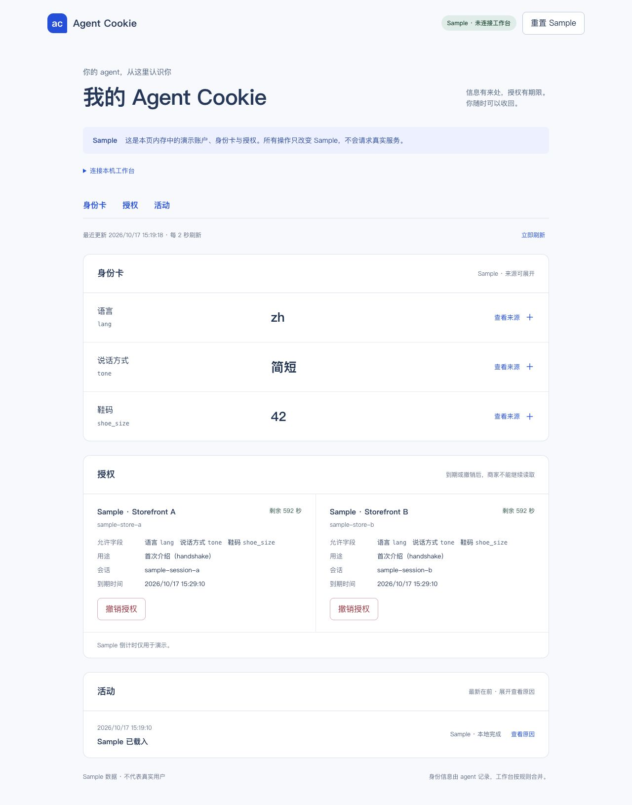

# C18 · 从固定商品示例改为本次意图

2026-10-17，lane-c 基于人已合并的 `1d0ffff`。人的新要求覆盖旧固定示例；`docs/plan.md` 未修改，`docs/requests.md` 仅追加跨线事项。

- 控制台身份卡、候选、历史与授权显示返回的字段 key 和可用的友好名称；未知名称不丢失。Sample 授权来自当前 seed 的有效字段，不锁定某一商品字段。
- 历史 HTTP 验收按实际 HTTP 卡及本次 intent 计算期望，检查本次预算与接收地址的被选商家。受控测试输入仍有数值，但不把它们当演示必须满足的价格或尺码。
- 4:10 分镜从现场真实需求开始，缺资料如实澄清，不预定店名、金额或尺码；三条备选分别录了公开 catalog 支撑响应，完整 iMessage 录像仍待 B。

控制台验证：20/20 Vitest、typecheck、production build 通过。浏览器在真实 `127.0.0.1:5173` 确认卡片与授权都显示 key；页面截图保留实际 Sample 值，这些值不是测试期望或产品约束。

HTTP 验收在独立 `127.0.0.1:4328` 和临时数据目录验证，工作台为 `8c1a869` 历史基线：12 个既有执行项 + 4 个性质 helper 通过，11 个 todo 保留。A01–A22 编号标题不变，未当作 A 线当前 P0 的重跑。详见 [验收 README](../../tests/acceptance/README.md)。

三次公开 catalog 实录的哈希、JSON pointer、预算、商家数量及尺码未核对说明均由 `node fixtures/ucp/verify-needs.mjs` 检查通过，见 [R1–R3](recorded-needs/README.md)。它没有认证适码、商品特性或完整 A17。读取 4310 卡使用 SDK，无 owner key/地址写入材料；没有重置该后台。

未完成边界：SDK/Photon 通用意图入口、A 普通 callback 路径商家数/预算约束、尺码不符的用户可见输出，以及 B 的三条连续手机原片。C11 继续 P1 BLOCKED。上述事项已追加 requests，不扩大 C 的目录权限修补其他线。
