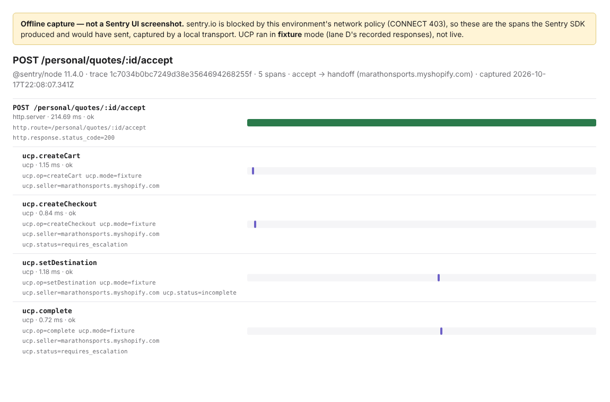

# T8 Sentry：tracing + logs（A 线，2026-10-17）

**结论：工作台已接入 Sentry 的 tracing 和 logs 两个产品，离线验证通过。没有 Sentry 后台截图：本环境的网络策略拒绝 sentry.io（`o0.ingest.sentry.io` → CONNECT 403），数据发不出去。下面那张图是本机捕获的 span 渲染，图里写明了“不是 Sentry UI 截图”。**

## 接了什么

- `SENTRY_DSN` 设了才启用（`SENTRY_ENVIRONMENT`，`SENTRY_TRACES_SAMPLE_RATE` 默认 1）；不设时所有调用都是空操作。SDK：`@sentry/node` 11.4.0（锁定版本）。
- **Tracing**：每个 HTTP 请求一个根 span（`op=http.server`，名字是路由模板，如 `POST /personal/quotes/:id/accept`，不含路径参数和查询串），每个请求各自一条 trace。每次 UCP 调用一个子 span `ucp.<op>`（`op=ucp`），属性：`ucp.mode`、`ucp.seller`、`ucp.status`、`ucp.offers`。
- **Logs**：活动日志每一行发一条 Sentry log（`event`、`actor`、`result`、`reason`；不发 `object`，即 session / quote id）；每次 UCP 调用发一条 `ucp.<op>` log（成功/失败、耗时、状态）。未处理异常走 `captureException`。
- **隐私**：不收集请求/响应 body、header、cookie、查询串、用户信息、栈帧局部变量、数据库语句。`tracePropagationTargets: []`：发给商家的回调和 Tier 0 请求**不带** `sentry-trace` / `baggage` / `traceparent`。同一个 trace id 出现在两家店的请求上，就能把同一个用户在两家之间关联起来，等于绕过了成对 session ID。

## 验证

- `apps/workspace/test/telemetry.test.ts`：用自定义 transport 捕获 SDK 要发的 envelope，断言：
  - intent 请求下有 `ucp.searchOffers`；accept 请求下依次有 `ucp.createCart → createCheckout → setDestination → complete`，都挂在该请求的根 span 下，`ucp.seller` 正确，最后状态 `requires_escalation`；
  - 有 `activity`（`quote.accept`）和 `ucp.complete` 两类 log；
  - 发出的全部内容里没有地址、钥匙、查询串、意图原文、`authorization` / `cookie`；
  - 商家收到的请求里没有 trace 头。
- 离线 trace 渲染：`apps/workspace/scripts/trace-capture.ts` 在真实接线上（fixture 模式回放 D 线录制、C 线种子、临时 git 记忆库）跑一次 intent + accept，捕获 span：
  - [T8-sentry-offline-trace.json](T8-sentry-offline-trace.json)（11 个 span，accept 这条 trace 5 个）
  - 

## 还欠

- 一张真实的 Sentry 后台 trace 截图：允许 `*.ingest.sentry.io`（或 `*.ingest.us.sentry.io`，看项目所在区域）和 `sentry.io` 后，设 `SENTRY_DSN` 起工作台，跑一次 accept，在 Sentry 的 Traces 里打开 `POST /personal/quotes/:id/accept` 截图。
