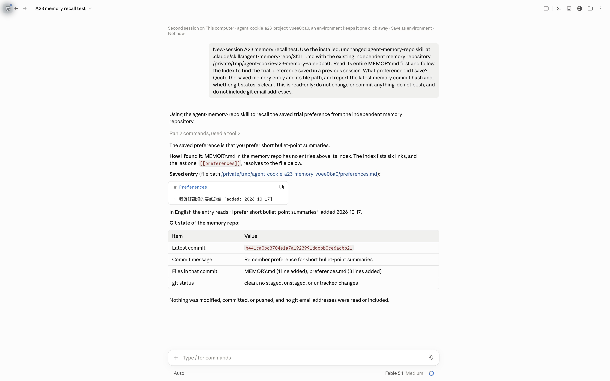

# A23 · Cognition stock Agent Memory Repo skill 互操作（P1）

状态：**A23 实际试跑通过**（2026-10-17 PDT）。未修改的 stock skill 已在 Claude Desktop Code 保存并提交；独立新会话读回成功。同一记忆库随后完成真实工作台 contribute、purpose 回执和限定重置。自动 Synthetic 支撑单独运行，也全部通过。最终 C21+B49 版本已再次通过同库 HTTP/reset，Git 失败恢复回归也已通过；本试跑不代表真实模型学习验收。

## 标准与我们的扩展

规范读取命令：

```sh
gh api repos/AgentMemoryRepo/agentmemoryrepo/contents/SPEC.md --jq .content | base64 -d
npx --yes skills add AgentMemoryRepo/agentmemoryrepo --skill agent-memory-repo --agent claude-code --yes
```

上游：[SPEC.md](https://github.com/AgentMemoryRepo/agentmemoryrepo/blob/8798cb26c817d451a5ed6cba0ad8d9eca8d5ec3e/SPEC.md)、[README](https://github.com/AgentMemoryRepo/agentmemoryrepo/blob/8798cb26c817d451a5ed6cba0ad8d9eca8d5ec3e/README.md)、[未修改的 stock skill](https://github.com/AgentMemoryRepo/agentmemoryrepo/blob/8798cb26c817d451a5ed6cba0ad8d9eca8d5ec3e/skills/agent-memory-repo/SKILL.md)。[安装输出](A23/stock-skill-install.txt) · [版本与哈希](A23/stock-version.json)。

规范定义自由布局、短 MEMORY.md 入口、`## Index` 与根相对 `[[path]]`（Markdown省略.md）、一行一条 bullet、开放 `[key: value; key: value]` 元数据，推荐 source/added。它不规定 Agent Cookie 的目录、字段策略、授权或重置。

我们的扩展是工作台自管 `contributions/`、`notes/`、`CARD.md`、`receipts.md`；这些路径只能通过CLI/HTTP写。其他 topic/scripts/Index 由普通memory skill自由管理。CARD只由确定性rules生成；POLICY.yaml从正式POLICY_TABLE生成；added来自时间戳，source采用conversation/intent/receipt标识。reset仅恢复四个自管路径，保留其他文件和所有提交历史。陌生商家仍不能直接访问整个记忆repo。

## 隔离环境

- 主分支基线：人已合PR18/19后的 main `32490f1`，加本次C21改动。
- 项目：`/private/tmp/agent-cookie-a23-project-vuee0ba0`，只安装stock skill；记忆库位于独立的 `/private/tmp/agent-cookie-a23-memory-vuee0ba0`，不在项目内。
- 专用工作台使用 `127.0.0.1:4331`；自动Synthetic用另一份数据和4332。不会重置用户正在看的4310。
- CLI auth status为未登录，沿用用户此前许可的Claude Desktop Code本机模式；不读取或搬运登录凭据，不改stock skill，不配置远程repo。

## 实际 Claude Code 两会话

[精确输入和独立会话标识](A23/claude-prompts.json)。第一会话 `local_9afd9e64-6456-4002-9e2c-ef66c26b5a17` 先读取原版 skill、完整 MEMORY.md 和五个 Index 目标，再创建根目录 `preferences.md`、向 Index 加 `[[preferences]]`。它提交的结果为：

```text
Saved path: /private/tmp/agent-cookie-a23-memory-vuee0ba0/preferences.md
- 我偏好简短的要点总结 [added: 2026-10-17]
Commit: b441ca0bc3704e1a7a1923991ddcbb0ce6acbb21
Author: BIBOYANG425
Files: MEMORY.md, preferences.md
Memory repo git status --porcelain: empty
Project repo: clean; installed skill unchanged; no remote or push
```

以上由 UI 输出与本机 Git 独立核对。第二会话 `local_dc93c712-2aeb-4b2f-9b94-b215a3924feb` 的输入只给了记忆库路径和读取任务，**没有给偏好内容或首会话回答**。它实际调用 `/agent-memory-repo`、沿 `[[preferences]]` 读回同一句偏好，并报告相同 commit、clean 状态和没有修改任何文件。



运行后 `git hash-object .claude/skills/agent-memory-repo/SKILL.md` 仍为 `171c82b59524654ad86d34b74a606a3026730642`，与上游 Git blob 完全相同。原版 skill 没有加入 Agent Cookie 专用适配；四路径边界只在用户任务中告知。

## 同一记忆库的工作台验证

[真实 HTTP 与 Git 结果](A23/actual-workspace-probe.json)。它使用真实 A 工作台、SQLite 与 C Git adapter；商家 callback/报价是明确标记的 Sample，本验收不进行真实购物或支付。

- `POST /personal/contributions` 201；`GET /personal/card` 200，并在指定记忆库 `CARD.md` 找到本轮唯一 tone 值，确认 HTTP 目标确实写到这份 repo。
- Sample 商家注册、intent/quote 创建、accept handoff 成功；`GET /agent/fields?…&purpose=checkout` 200，只有 accept 后读取 Sample 地址；回执写入 `receipts.md`，有 `added` 和 `source: receipt/<id>`。
- note 写入 200，四个自管路径均确认相对 seed 有变化。共 10 次 HTTP 请求全部为 200/201，无 500。
- owner `POST /demo/reset` 200；四路径与 `fixtures-seed` 零差异且无未跟踪文件；`MEMORY.md`、`preferences.md`、`POLICY.yaml` 和 archive README 的 SHA-256 不变，六个 Index 链接均可解析。
- Git log 同时保留 skill、personal 和 workspace 的提交；reset 产生新的限定路径提交，旧提交均为祖先；最终整个工作树 clean。`intents/` 历史也保留，因为它不在本次四路径 reset 范围内。

复核命令（都只针对本次隔离 repo）：

```sh
git -C /private/tmp/agent-cookie-a23-memory-vuee0ba0 log --format='%H %an %s'
git -C /private/tmp/agent-cookie-a23-memory-vuee0ba0 status --porcelain=v1 --untracked-files=all
git -C /private/tmp/agent-cookie-a23-memory-vuee0ba0 diff --name-only fixtures-seed -- contributions notes CARD.md receipts.md
git -C /private/tmp/agent-cookie-a23-project-vuee0ba0 status --porcelain=v1
git hash-object /private/tmp/agent-cookie-a23-project-vuee0ba0/.claude/skills/agent-memory-repo/SKILL.md
```

工作台启动命令（Node 22；fixtures 指向 main 32490f1 + C21 的独立运行副本）：

```sh
AGENT_COOKIE_DEMO=1 AGENT_COOKIE_UCP=fixture PORT=4331 \
AGENT_COOKIE_URL=http://127.0.0.1:4331 \
AGENT_COOKIE_DATA_DIR=/private/tmp/agent-cookie-a23-data-vuee0ba0 \
MEMORY_REPO_PATH=/private/tmp/agent-cookie-a23-memory-vuee0ba0 \
pnpm --filter @agent-cookie/workspace start
```

## 自动化覆盖与边界

`tests/acceptance/memory-interop.test.ts` 的 A23(c,d) 在另一份 4332 隔离实例完成；[7 项 Vitest 结果](A23/automated-interop-vitest.txt)包含 2 项真实 HTTP/Git 互操作与 5 项入口安全检查。Synthetic 普通 agent 的提交只用于可重复自动测试，不替代上述 Claude Code 保存/读回证据。运行方法见 [tests/acceptance/README](../../tests/acceptance/README.md)。

[要求的全套测试摘要](A23/required-suites.txt)：rules **70/70**、memory-repo **48/48**、workspace **234 通过 / 4 todo**，三包类型检查通过；workspace 原有四项 todo 不计入通过数。包括真实 Git ref lock 导致提交失败后的限定回滚，以及 B49 的证据来源、批量撤销和接力作者回归。[最终源码 SHA-256 基线](A23/implementation-baseline.json)可与提交核对。

跨线剩余交接：`skills/agent-cookie/SKILL.md` 归 B；CLAUDE.md/AGENTS.md 和 reset 契约注释归人/A。本线未越目录修改，已追加 [requests](../requests.md)。它们是 Agent Cookie 自有接入手册的更新，未妨碍本次未修改 Cognition stock skill 的互操作通过。
